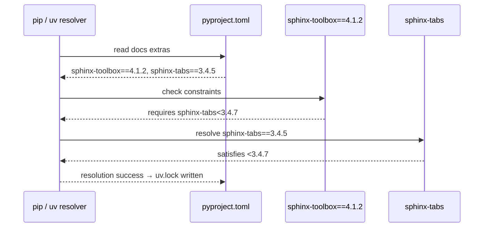

# Issue

**Title:** Fix sphinx-tabs/sphinx-toolbox dependency conflict

## Description

`sphinx-toolbox==4.1.2` requires `sphinx-tabs<3.4.7`, which conflicts with the previously pinned `sphinx-tabs==3.4.7`, causing `ResolutionImpossible` errors in docs install CI.

## Changes
- Downgraded `sphinx-tabs` pin from `3.4.7` → `3.4.5` (highest version satisfying `sphinx-toolbox 4.1.2`'s constraint) in `pyproject.toml`
- Regenerated `uv.lock`

<!-- greptile_comment -->

<h3>Greptile Summary</h3>

This PR resolves a `ResolutionImpossible` error in docs install CI by downgrading the `sphinx-tabs` pin from `==3.4.7` to `==3.4.5`, which satisfies `sphinx-toolbox==4.1.2`'s declared `sphinx-tabs<3.4.7` upper bound. The `uv.lock` is regenerated accordingly, picking up a lockfile format revision bump (1 → 3) that adds `upload-time` metadata to every package entry.

- `pyproject.toml`: single-line version pin change (`sphinx-tabs==3.4.7` → `==3.4.5`) under the `docs` extras group.
- `uv.lock`: full re-resolution with `sphinx-tabs 3.4.5` now resolved; all package hashes and sizes are preserved; only `upload-time` fields and the `revision` header are new additions from the updated uv format.

<h3>Confidence Score: 5/5</h3>

Safe to merge; the only functional change is a one-line docs-dependency version pin that unblocks CI.

The change is limited to the docs extras group and has no effect on the runtime package or its tests. sphinx-tabs 3.4.5 is a stable release that satisfies sphinx-toolbox 4.1.2's constraint, and the lockfile correctly reflects the resolved version with all hashes intact.

No files require special attention.

<h3>Important Files Changed</h3>

| Filename | Overview |
|----------|----------|
| pyproject.toml | Downgraded sphinx-tabs pin from ==3.4.7 to ==3.4.5 to satisfy sphinx-toolbox==4.1.2's <3.4.7 constraint; no other changes. |
| uv.lock | Lockfile regenerated with sphinx-tabs resolved to 3.4.5; revision bumped from 1 → 3 and upload-time metadata fields added to all package entries (uv format upgrade), hashes intact. |

<h3>Sequence Diagram</h3>

Reviews (1): Last reviewed commit:  | [Re-trigger Greptile](https://app.greptile.com/api/retrigger?id=30958525)

<!-- /greptile_comment -->

## Task

Modify the repository so that the issue described above is resolved. The repository is checked out at base commit `4f1e867639a7`. Edit files in place; the verifier captures your changes via `git diff` and scores them against an oracle patch using SWE-RL-style diff-similarity reward.