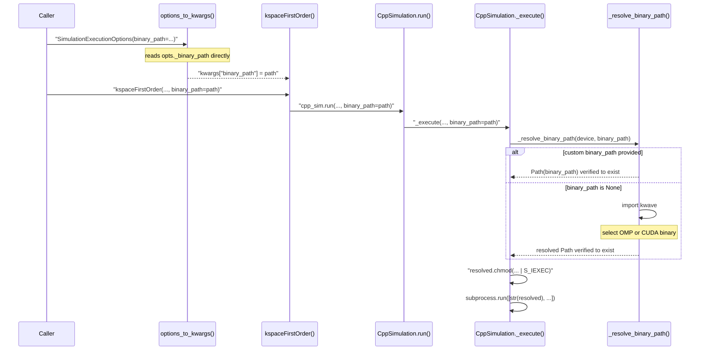

# Issue

**Title:** Fix binary_path silently dropped by options_to_kwargs()

## Description

- [x] Extract binary path resolution into `CppSimulation._resolve_binary_path(device, binary_path)` static method with type annotations
- [x] Add tests for `_resolve_binary_path`: custom path valid, custom path missing, default OMP, default CUDA, macOS GPU error, non-macOS GPU missing binary
- [x] Add test verifying `_execute()` sets executable bit on binary
- [x] Improve comment in `compat.py` explaining why `_binary_path` is accessed directly
- [x] Move `import kwave` inside the default-path branch to avoid unnecessary import when custom binary is provided (reviewer feedback)

<!-- greptile_comment -->

<h3>Greptile Summary</h3>

This PR fixes a bug where `binary_path` set on `SimulationExecutionOptions` was silently ignored by `options_to_kwargs()` because the property getter auto-resolved to a default value, making it impossible to distinguish a user-set path from the bundled default. The fix reads `_binary_path` directly and propagates it through `kspaceFirstOrder` → `CppSimulation.run` → `_execute`.

- **`compat.py`**: Reads `opts._binary_path` (the backing attribute) instead of `opts.binary_path` (the auto-resolving property), and forwards it as `kwargs[\"binary_path\"]`.
- **`cpp_simulation.py`**: Extracts binary-path resolution into `_resolve_binary_path()` as a testable static method; the `import kwave` statement is correctly deferred inside the default-path branch so the bundled-binary lookup is skipped when a custom path is supplied.
- **`tests/`**: New unit tests cover the resolver's custom-path, default OMP/CUDA, missing-binary, and macOS GPU branches, plus a dedicated test that `_execute()` sets the executable bit.

<h3>Confidence Score: 5/5</h3>

Safe to merge — the change is a targeted bug fix with no regressions to existing behaviour.

The fix correctly targets the root cause: the `binary_path` property on `SimulationExecutionOptions` auto-resolves to a default, so reading `_binary_path` directly is the right approach. The `import kwave` deferral, the static-method extraction, and all new tests are correct. No existing code paths are altered except adding the missing propagation.

No files require special attention.

<h3>Important Files Changed</h3>

| Filename | Overview |
|----------|----------|
| kwave/compat.py | Core bug fix: accesses `opts._binary_path` directly to avoid the auto-resolving property, correctly forwarding user-set binary paths. |
| kwave/solvers/cpp_simulation.py | Refactors binary resolution into a testable static method with correct lazy `import kwave` placement; `_execute` propagates `binary_path` cleanly. |
| kwave/kspaceFirstOrder.py | Adds `binary_path` parameter to the public API and threads it through to `CppSimulation.run`; ignored for non-cpp backends as documented. |
| tests/test_compat.py | New `test_binary_path` test verifies the compat layer correctly forwards `_binary_path`; uses constructor-level assignment so the non-existent path doesn't need to exist on disk. |
| tests/test_cpp_simulation.py | Comprehensive new test file covering all resolver branches and the `chmod` side-effect in `_execute`; patching approach is correct for static methods. |

<h3>Sequence Diagram</h3>

Reviews (7): Last reviewed commit:  | [Re-trigger Greptile](https://app.greptile.com/api/retrigger?id=31705986)

<!-- /greptile_comment -->

## Task

Modify the repository so that the issue described above is resolved. The repository is checked out at base commit `9f25de186252`. Edit files in place; the verifier captures your changes via `git diff` and scores them against an oracle patch using SWE-RL-style diff-similarity reward.