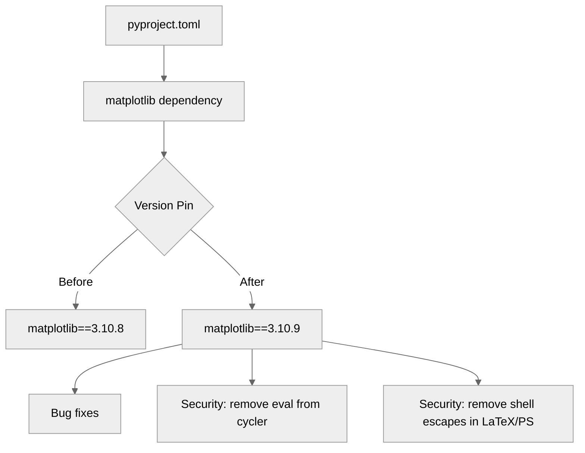

# Issue

**Title:** Bump matplotlib from 3.10.8 to 3.10.9

## Description

Bumps [matplotlib](https://github.com/matplotlib/matplotlib) from 3.10.8 to 3.10.9.

Release notes

<em>Sourced from <a href="https://github.com/matplotlib/matplotlib/releases">matplotlib's releases</a>.</em>

<blockquote>
<h2>v3.10.9</h2>

This is a micro release of the v3.10.x series.
Highlights of this release include:

<ul>
<li>Various minor bug and doc fixes</li>
<li>Security hardening validation of cyclers - Removing eval usage</li>
<li>Security hardening in Latex and PS calls - Removing shell escapes</li>
</ul>
</blockquote>

Commits

<ul>
<li><a href=""><code>dd8d78b</code></a> REL: v3.10.9</li>
<li><a href=""><code>2fb1891</code></a> REL: Release prep v3.10.9</li>
<li><a href=""><code>d0e923a</code></a> Merge branch 'v3.10.8-doc' into v3.10.x</li>
<li><a href=""><code>1637932</code></a> Merge pull request <a href="">#31558</a> from meeseeksmachine/auto-backport-of-pr-31556-on-v...</li>
<li><a href=""><code>a83faac</code></a> Backport PR <a href="">#31556</a>: FIX: Inverted PyErr_Occurred check in enum type caster (_...</li>
<li><a href=""><code>a4f57ab</code></a> Merge pull request <a href="">#31545</a> from ksunden/backport-of-pr-31282-on-v3.10.x</li>
<li><a href=""><code>063288d</code></a> Merge pull request <a href="">#31544</a> from ksunden/backport-of-pr-31248-on-v3.10.x</li>
<li><a href=""><code>b2ed196</code></a> Backport PR <a href="">#31248</a>: SEC: Remove eval() from validate_cycler</li>
<li><a href=""><code>acc6024</code></a> Merge pull request <a href="">#31282</a> from scottshambaugh/tex_no_shell</li>
<li><a href=""><code>e3fb541</code></a> Merge pull request <a href="">#31078</a> from meeseeksmachine/auto-backport-of-pr-31075-on-v...</li>
<li>Additional commits viewable in <a href="https://github.com/matplotlib/matplotlib/compare/v3.10.8...v3.10.9">compare view</a></li>
</ul>

 

Dependabot will resolve any conflicts with this PR as long as you don't alter it yourself. You can also trigger a rebase manually by commenting `@dependabot rebase`.

[//]: # (dependabot-automerge-start)
[//]: # (dependabot-automerge-end)

---

Dependabot commands and options

 

You can trigger Dependabot actions by commenting on this PR:
- `@dependabot rebase` will rebase this PR
- `@dependabot recreate` will recreate this PR, overwriting any edits that have been made to it
- `@dependabot show <dependency name> ignore conditions` will show all of the ignore conditions of the specified dependency
- `@dependabot ignore this major version` will close this PR and stop Dependabot creating any more for this major version (unless you reopen the PR or upgrade to it yourself)
- `@dependabot ignore this minor version` will close this PR and stop Dependabot creating any more for this minor version (unless you reopen the PR or upgrade to it yourself)
- `@dependabot ignore this dependency` will close this PR and stop Dependabot creating any more for this dependency (unless you reopen the PR or upgrade to it yourself)

<!-- greptile_comment -->

<h3>Greptile Summary</h3>

This PR bumps the pinned `matplotlib` dependency from `3.10.8` to `3.10.9`, a micro release within the same minor version series. The 3.10.9 release includes minor bug/doc fixes and two security hardening changes: removal of `eval()` from cycler validation and removal of shell escapes from LaTeX/PS calls.

- **`pyproject.toml`**: Single version string change (`matplotlib==3.10.8` → `matplotlib==3.10.9`). No other dependencies or configuration are affected.
- The update is backwards-compatible within the 3.10.x series, and the security fixes make it a desirable upgrade over the previous pin.

<h3>Confidence Score: 5/5</h3>

Safe to merge — this is a single version string update to a patch-level release of matplotlib with no breaking changes expected.

The change is a one-line patch-version pin bump within the same minor series. The 3.10.9 release is a security-hardening micro release with no API changes, making it a straightforward and low-risk update.

No files require special attention.

<h3>Important Files Changed</h3>

| Filename | Overview |
|----------|----------|
| pyproject.toml | Bumps the pinned matplotlib dependency from 3.10.8 to 3.10.9 (micro/patch release with bug fixes and security hardening). |

<h3>Flowchart</h3>

Reviews (1): Last reviewed commit:  | [Re-trigger Greptile](https://app.greptile.com/api/retrigger?id=31712195)

<!-- /greptile_comment -->

## Task

Modify the repository so that the issue described above is resolved. The repository is checked out at base commit `4b110afbd400`. Edit files in place; the verifier captures your changes via `git diff` and scores them against an oracle patch using SWE-RL-style diff-similarity reward.