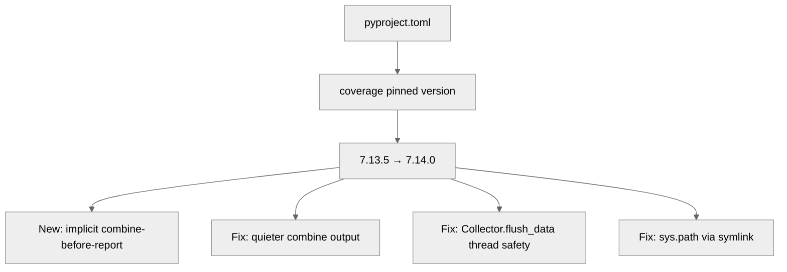

# Issue

**Title:** Bump coverage from 7.13.5 to 7.14.0

## Description

Bumps [coverage](https://github.com/coveragepy/coveragepy) from 7.13.5 to 7.14.0.

Changelog

<em>Sourced from <a href="https://github.com/coveragepy/coveragepy/blob/main/CHANGES.rst">coverage's changelog</a>.</em>

<blockquote>
<h2>Version 7.14.0 — 2026-05-10</h2>
<ul>
<li>

Feature: now when running one of the reporting commands, if there are
parallel data files that need combining, they will be implicitly combined
before creating the report. There is no option to avoid the combination; let
us know if you have a use case that requires it.  Thanks, <code>Tim Hatch &lt;pull 2162_&gt;</code><em>. Closes <code>issue 1781</code></em>.

</li>
<li>

Fix: the output from <code>combine</code> was too verbose, listing each file
considered. Now it shows a single line with the counts of files combined,
files skipped, and files with errors. The <code>-q</code> flag suppresses this line.
The old detailed lines are available with the new <code>--debug=combine</code> option.

</li>
<li>

Fix: running a Python file through a symlink now sets the sys.path correctly,
matching regular Python behavior. Fixes <code>issue 2157</code>_.

</li>
<li>

Fix: <code>Collector.flush_data</code> could fail with &quot;RuntimeError: Set changed
size during iteration&quot; when a tracer in another thread added a line to the
per-file set that <code>add_lines</code> (or <code>add_arcs</code>) was iterating. The values
passed to <code>CoverageData</code> are now snapshotted via <code>dict.copy()</code> and
<code>set.copy()</code>, which are atomic under the GIL. Thanks, <code>Alex Vandiver &lt;pull 2165_&gt;</code>_.

</li>
<li>

Fix: the soft keyword <code>lazy</code> is now bolded in HTML reports.

</li>
<li>

We are no longer testing eventlet support. Eventlet started issuing stern
deprecation warnings that break our tests. Our support code is still there.

</li>
</ul>

.. _issue 1781: <a href="">coveragepy/coveragepy#1781</a>
.. _issue 2157: <a href="">coveragepy/coveragepy#2157</a>
.. _pull 2162: <a href="">coveragepy/coveragepy#2162</a>
.. _pull 2165: <a href="">coveragepy/coveragepy#2165</a>

.. _changes_7-13-5:

</blockquote>

Commits

<ul>
<li><a href=""><code>646351b</code></a> docs: sample HTML for 7.14.0</li>
<li><a href=""><code>39cd015</code></a> docs: prep for 7.14.0</li>
<li><a href=""><code>649e8aa</code></a> docs: thanks Alex Vandiver for <a href="">#2165</a></li>
<li><a href=""><code>8cd392e</code></a> fix: snapshot data in Collector.flush_data to avoid threading race (<a href="">#2165</a>)</li>
<li><a href=""><code>c48e0ed</code></a> fix: less output for combining</li>
<li><a href=""><code>c2a3a28</code></a> docs: explain the change from <a href="">#2162</a></li>
<li><a href=""><code>1cd47aa</code></a> fix: implicit combine-during-report now removes the combined data files</li>
<li><a href=""><code>2d99fd7</code></a> feat: automatically combine coverage in report, thanks Tim Hatch (<a href="">#2162</a>)</li>
<li><a href=""><code>9fbdcdf</code></a> fix: lazy soft keywords are bolded</li>
<li><a href=""><code>5de7d02</code></a> build: oops, misplaced quote</li>
<li>Additional commits viewable in <a href="https://github.com/coveragepy/coveragepy/compare/7.13.5...7.14.0">compare view</a></li>
</ul>

 

Dependabot will resolve any conflicts with this PR as long as you don't alter it yourself. You can also trigger a rebase manually by commenting `@dependabot rebase`.

[//]: # (dependabot-automerge-start)
[//]: # (dependabot-automerge-end)

---

Dependabot commands and options

 

You can trigger Dependabot actions by commenting on this PR:
- `@dependabot rebase` will rebase this PR
- `@dependabot recreate` will recreate this PR, overwriting any edits that have been made to it
- `@dependabot show <dependency name> ignore conditions` will show all of the ignore conditions of the specified dependency
- `@dependabot ignore this major version` will close this PR and stop Dependabot creating any more for this major version (unless you reopen the PR or upgrade to it yourself)
- `@dependabot ignore this minor version` will close this PR and stop Dependabot creating any more for this minor version (unless you reopen the PR or upgrade to it yourself)
- `@dependabot ignore this dependency` will close this PR and stop Dependabot creating any more for this dependency (unless you reopen the PR or upgrade to it yourself)

<!-- greptile_comment -->

<h3>Greptile Summary</h3>

Bumps the pinned `coverage` test dependency from 7.13.5 to 7.14.0 in `pyproject.toml`. The new release is a minor version update with no breaking changes.

- **Implicit combine-before-report** (new feature): when parallel `.coverage.*` data files exist, coverage will now automatically combine them before generating a report. This could change CI behaviour if the project collects parallel coverage data, but the test extras here use `coverage` directly so the impact is limited.
- **Bug fixes**: quieter `combine` output, thread-safety fix in `Collector.flush_data`, and correct `sys.path` when running a file through a symlink.

<h3>Confidence Score: 5/5</h3>

Safe to merge — only a single-line version bump for a test-only dependency with no breaking changes in the new release.

The change touches only the pinned `coverage` version used in testing. The 7.14.0 release adds a quality-of-life auto-combine feature and three bug fixes; none affect library behaviour or the project's own code.

No files require special attention.

<h3>Important Files Changed</h3>

| Filename | Overview |
|----------|----------|
| pyproject.toml | Bumps the pinned `coverage` version from 7.13.5 to 7.14.0 in the test extras |

<h3>Flowchart</h3>

Reviews (1): Last reviewed commit:  | [Re-trigger Greptile](https://app.greptile.com/api/retrigger?id=31712221)

<!-- /greptile_comment -->

## Task

Modify the repository so that the issue described above is resolved. The repository is checked out at base commit `4b110afbd400`. Edit files in place; the verifier captures your changes via `git diff` and scores them against an oracle patch using SWE-RL-style diff-similarity reward.