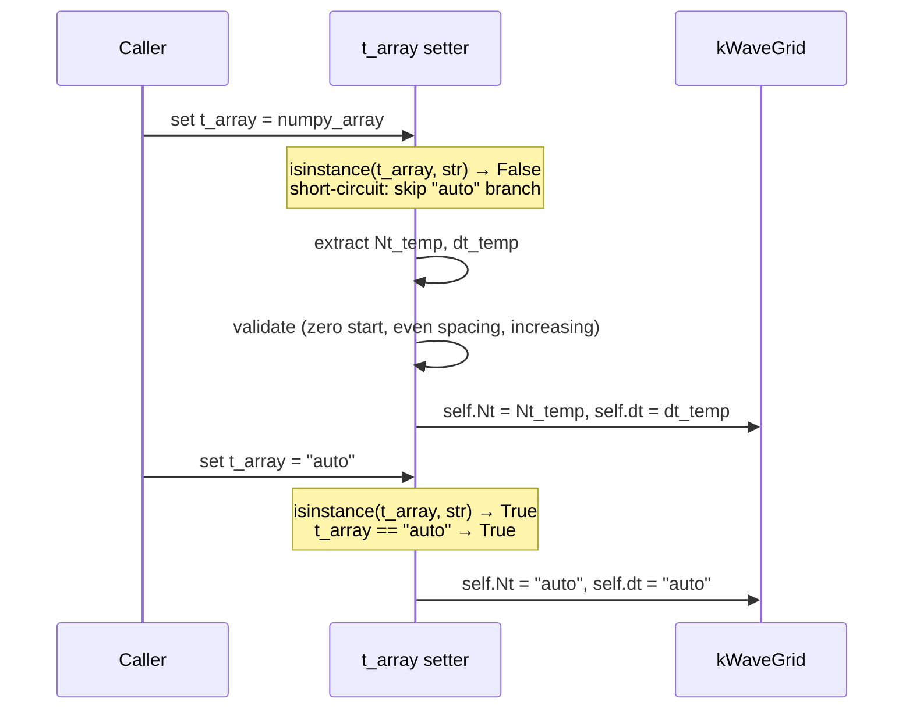

# Issue

**Title:** fix: fix t_array setter ValueError when passing numpy array

## Description

Fixes the t_array setter which raises `ValueError: The truth value of an array with more than one element is ambiguous` when trying to set a numpy array.

The issue was that `t_array == 'auto'` returns a boolean array when `t_array` is a numpy array, causing the `if` statement to fail.

Fixed by using `isinstance(t_array, str) and t_array == 'auto'` instead.

<!-- greptile_comment -->

<h3>Greptile Summary</h3>

This PR fixes a `ValueError: The truth value of an array with more than one element is ambiguous` crash in the `t_array` setter by guarding the `== "auto"` comparison with an `isinstance(t_array, str)` check, which short-circuits before NumPy can produce a boolean array.

- The one-line change in `kwave/kgrid.py` replaces `if t_array == "auto":` with `if isinstance(t_array, str) and t_array == "auto":`, correctly handling both string (`"auto"`) and numpy array inputs.
- The existing `self.Nt == "auto"` / `self.dt == "auto"` comparisons in the getter (line 100) remain unaffected because those attributes are always plain strings or scalars, not numpy arrays.

<h3>Confidence Score: 5/5</h3>

Safe to merge — the change is a minimal, well-targeted guard that fixes a crash without altering any other behavior.

The fix is a single-line change that correctly handles both the existing 'auto' string path and the previously broken numpy array path. The isinstance short-circuit is the idiomatic Python solution, the rest of the setter is untouched, and the getter's own 'auto' comparisons operate on plain scalar attributes so they are unaffected.

No files require special attention.

<h3>Important Files Changed</h3>

| Filename | Overview |
|----------|----------|
| kwave/kgrid.py | Single-line fix to t_array setter: guards the 'auto' string comparison with an isinstance check to prevent ValueError when a numpy array is passed. |

<h3>Sequence Diagram</h3>

Reviews (1): Last reviewed commit:  | [Re-trigger Greptile](https://app.greptile.com/api/retrigger?id=32448949)

<!-- /greptile_comment -->

## Task

Modify the repository so that the issue described above is resolved. The repository is checked out at base commit `9f25de186252`. Edit files in place; the verifier captures your changes via `git diff` and scores them against an oracle patch using SWE-RL-style diff-similarity reward.