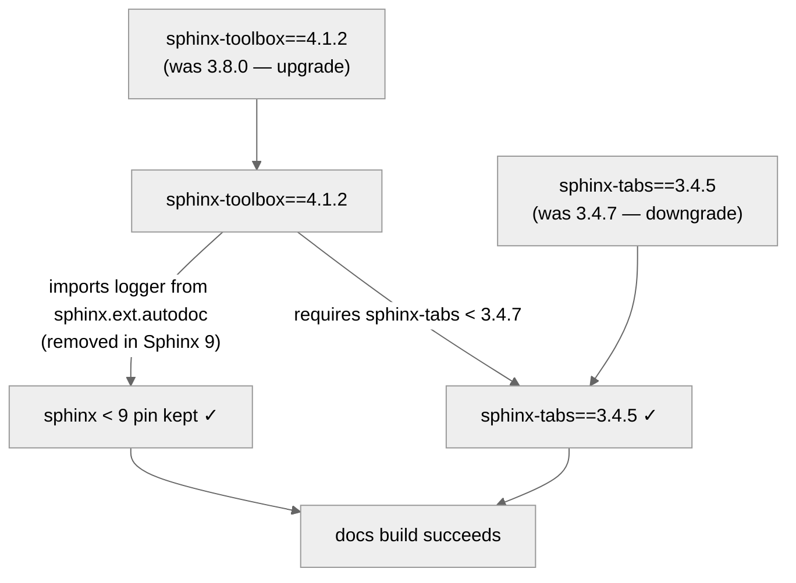

# Issue

**Title:** Bump sphinx-toolbox 3.8.0 -> 4.1.2 and sphinx-tabs 3.4.7 -> 3.4.5

## Description

## Summary

- Bumps `sphinx-toolbox` from `3.8.0` to `4.1.2` and `sphinx-tabs` from `3.4.7` to `3.4.5`.
- `sphinx-toolbox 4.1.2` strictly requires `sphinx-tabs<3.4.7`, so tabs is pinned to `3.4.5` (the highest version that satisfies the constraint). Going to tabs `3.5.0` (what dependabot wanted in #721) would require `sphinx-toolbox 4.2.0rc1`, a pre-release — not worth shipping in the docs extras for now.
- The `sphinx<9` pin from #714 is kept: I verified `sphinx-toolbox 4.1.2` still does `from sphinx.ext.autodoc import logger`, which Sphinx 9 removed (`ImportError: cannot import name 'logger' from 'sphinx.ext.autodoc'`).

Supersedes:
-  (toolbox 4.1.2 bump from dependabot)
-  (tabs 3.5.0 bump from dependabot — incompatible with toolbox 4.1.2)

## Test plan

- [x] `uv sync --extra docs` resolves cleanly with the new pins
- [x] `sphinx-build -b html docs/` succeeds locally (134 pre-existing warnings, build succeeds)
- [ ] CI matrix green (tests + linkChecker + ruff + docs/readthedocs)

🤖 Generated with [Claude Code](https://claude.com/claude-code)

<!-- greptile_comment -->

<h3>Greptile Summary</h3>

Bumps `sphinx-toolbox` from 3.8.0 to 4.1.2 and intentionally downgrades `sphinx-tabs` from 3.4.7 to 3.4.5 to satisfy `sphinx-toolbox 4.1.2`'s strict `sphinx-tabs<3.4.7` constraint. The `sphinx<9` pin is preserved because `sphinx-toolbox 4.1.2` still imports `logger` from `sphinx.ext.autodoc`, which Sphinx 9 removed.

- `pyproject.toml` updates both docs-extra pins with the correct compatible versions.
- `uv.lock` is regenerated and consistent with the new constraints in `pyproject.toml`.

<h3>Confidence Score: 5/5</h3>

This PR is safe to merge — it touches only documentation build dependencies with no impact on the library's runtime behaviour.

The change is limited to two version pins in the docs optional-dependency group. The downgrade of sphinx-tabs and the preserved sphinx<9 upper bound are both correctly motivated by real upstream constraints that the author verified. The uv.lock is fully consistent with the updated pyproject.toml pins.

No files require special attention.

<h3>Important Files Changed</h3>

| Filename | Overview |
|----------|----------|
| pyproject.toml | Updates sphinx-tabs (3.4.7→3.4.5) and sphinx-toolbox (3.8.0→4.1.2) in the docs extra; change is intentional and well-justified in the PR description. |
| uv.lock | Lock file regenerated to reflect new sphinx-tabs and sphinx-toolbox versions; metadata markers in lock are consistent with pyproject.toml pins. |

<h3>Flowchart</h3>

Reviews (2): Last reviewed commit:  | [Re-trigger Greptile](https://app.greptile.com/api/retrigger?id=32449270)

<!-- /greptile_comment -->

## Task

Modify the repository so that the issue described above is resolved. The repository is checked out at base commit `966dfdc48e63`. Edit files in place; the verifier captures your changes via `git diff` and scores them against an oracle patch using SWE-RL-style diff-similarity reward.