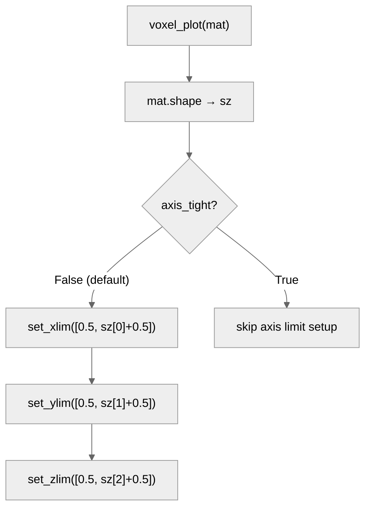

# Issue

**Title:** Fix #501: voxel_plot swapped x and z axes

## Description

## Summary

- . `voxel_plot` in `kwave/utils/plot.py` was using `sz[2]` for the x-axis limit and `sz[0]` for the z-axis limit, which mirrored the rendered output relative to the input array's first and last dimensions (and relative to MATLAB k-Wave's `voxelPlot`).
- Now `set_xlim/ylim/zlim` use `sz[0]/sz[1]/sz[2]` (the fix the issue reporter suggested).
- Added a regression test in `tests/test_utils.py` that calls `voxel_plot` on a `(4, 8, 12)` array (asymmetric so a swap is visible) and asserts each axis limit follows the corresponding shape dim.

## Test plan

- [x] New test `test_voxel_plot_axis_limits_match_input_shape` passes locally
- [x] `ruff check` + `ruff format --check` clean
- [ ] CI green

🤖 Generated with [Claude Code](https://claude.com/claude-code)

<!-- greptile_comment -->

<h3>Greptile Summary</h3>

Fixes the swapped x/z axis limits in `voxel_plot` — the old code mapped `sz[2]` to xlim and `sz[0]` to zlim, mirroring the output relative to the input array's first and last dimensions. The fix swaps them back so each axis limit follows the corresponding shape dimension, matching MATLAB k-Wave's `voxelPlot` behavior.

- **`kwave/utils/plot.py`**: Two-line swap restoring `set_xlim` → `sz[0]` and `set_zlim` → `sz[2]`.
- **`tests/test_utils.py`**: `matplotlib.use("Agg")` moved to module level (before `kwave.utils.plot` is imported, which itself imports `matplotlib.pyplot`), and a new regression test asserts each axis limit against the expected shape dimension using an asymmetric `(4, 8, 12)` array.

<h3>Confidence Score: 5/5</h3>

Safe to merge — the change is a minimal two-line swap that corrects a long-standing axis-mapping bug, backed by a targeted regression test.

The fix is isolated to two lines in voxel_plot, the logic is straightforward and directly matches the MATLAB reference implementation, and the new test uses an asymmetric array that would fail on the old code, confirming the correction.

No files require special attention.

<h3>Important Files Changed</h3>

| Filename | Overview |
|----------|----------|
| kwave/utils/plot.py | Minimal, correct two-line swap: xlim now uses sz[0] and zlim now uses sz[2], fixing the previously mirrored axis limits. |
| tests/test_utils.py | Adds module-level Agg backend setup and a regression test with an asymmetric array that directly asserts each axis limit; covers the fix thoroughly. |

<h3>Flowchart</h3>

Reviews (2): Last reviewed commit:  | [Re-trigger Greptile](https://app.greptile.com/api/retrigger?id=32449481)

<!-- /greptile_comment -->

## Task

Modify the repository so that the issue described above is resolved. The repository is checked out at base commit `9f25de186252`. Edit files in place; the verifier captures your changes via `git diff` and scores them against an oracle patch using SWE-RL-style diff-similarity reward.