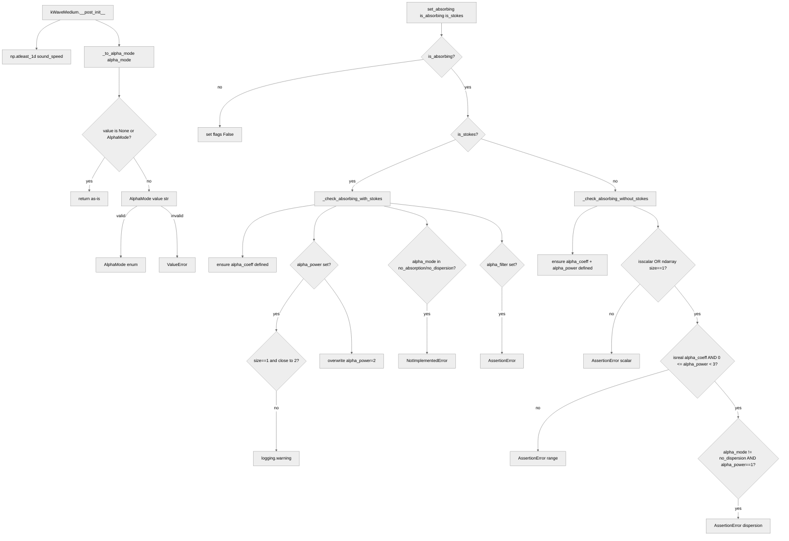

# Issue

**Title:** Fix kWaveMedium type annotations (rebased #636 + Greptile fixes)

## Description

## Summary

Rebases @TullyMonster's #636 onto current master and addresses the two open Greptile P2s. Original PR was stalled with merge conflicts after #705 (AlphaMode enum) landed.

## Changes from #636 as-is

- **Reconciled with master**: kept `Optional[Union[AlphaMode, str]]` annotation for `alpha_mode` (master's enum-aware version from #705 supersedes #636's `Optional[str]`); merged the new tests with master's `TestAlphaModeNormalization` class instead of overwriting.
- **Greptile P2 (unused import)**: removed `import kwave.utils.checks` — the old `is_number(...)` call was already replaced with `np.issubdtype(...)`, leaving the import dead.
- **Greptile P2 (0-d ndarray)**: the new type hint allows `np.ndarray` for `alpha_power`, but `np.isscalar(np.array(1.5))` is `False`, so the scalar check would reject 0-d arrays. Widened the check to accept single-element ndarrays. Regression test (`test_absorbing_without_stokes_alpha_power_accepts_0d_ndarray`) added.
- **One test updated**: `test_alpha_mode_validation_edge_cases` now asserts that empty-string `alpha_mode` is rejected at construction (master's `_to_alpha_mode` from #705), instead of at `check_fields`.

## Authorship

The substantive type-annotation work is @TullyMonster's. They're co-authored on the single squashed commit. .

## Test plan

- [x] All 27 tests in `tests/test_kmedium.py` pass locally
- [x] `ruff check .` clean
- [x] `ruff format --check` clean
- [ ] CI green

🤖 Generated with [Claude Code](https://claude.com/claude-code)

<!-- greptile_comment -->

<h3>Greptile Summary</h3>

This PR rebases #636 onto master, fixing type annotations across `kWaveMedium`, reconciling with the `AlphaMode` enum changes from #705, and addressing two previously flagged quality issues (dead `kwave.utils.checks` import and the 0-d ndarray scalar check).

- **Type annotation overhaul**: `np.array` stubs replaced with precise `Optional[Union[float, int, np.ndarray]]` annotations; `check_fields` parameter updated to `Sequence[int]`; `alpha_filter` / `alpha_sign` narrowed to `Optional[np.ndarray]`.
- **Scalar acceptance widened**: the `np.isscalar` guard in `_check_absorbing_without_stokes` now also accepts single-element `np.ndarray` values (0-d or 1-D), with a regression test added.
- **Validation clean-up**: `alpha_sign` check ported to `np.issubdtype`; `alpha_coeff` guard made `None`-safe; `logging.log(WARN, ...)` replaced with `logging.warning`; 27 new or updated tests cover all changed paths.

<h3>Confidence Score: 5/5</h3>

Safe to merge — the changes are scoped to type annotations, dead-code removal, and validation clean-up with no behavioural regressions on existing callers.

All changed validation paths have direct test coverage. The AlphaMode str-enum comparisons are correct throughout, the None-guard added to alpha_coeff in check_fields removes a latent crash, and the 0-d ndarray regression test confirms the widened scalar check works as intended. No path was left unguarded.

No files require special attention.

<h3>Important Files Changed</h3>

| Filename | Overview |
|----------|----------|
| kwave/kmedium.py | Type annotations tightened, dead import removed, validation logic cleaned up; logic is correct and consistent with AlphaMode str-enum comparisons. |
| tests/test_kmedium.py | 27 tests covering all new paths; logging patch target is correct; assertion match strings align with updated error messages. |

<h3>Flowchart</h3>

Reviews (3): Last reviewed commit:  | [Re-trigger Greptile](https://app.greptile.com/api/retrigger?id=32450241)

<!-- /greptile_comment -->

## Task

Modify the repository so that the issue described above is resolved. The repository is checked out at base commit `72608296258f`. Edit files in place; the verifier captures your changes via `git diff` and scores them against an oracle patch using SWE-RL-style diff-similarity reward.