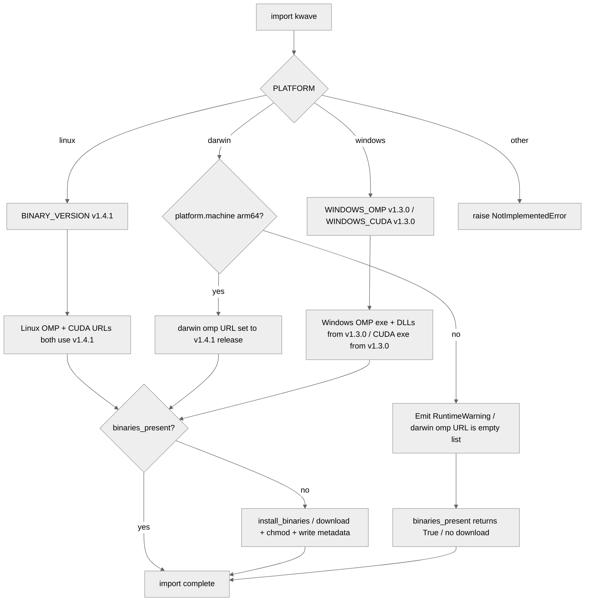

# Issue

**Title:** Bump BINARY_VERSION to v1.4.1 (sm_120 / Blackwell)

## Description

## Summary

- Bumps `BINARY_VERSION` to `v1.4.1` — the rebuilt static-linked Linux binaries + fast-math-fixed darwin binary published from .
- Bumps `__version__` to `0.6.2`.
- Keeps `WINDOWS_OMP_VERSION="v1.3.0"` pin — the new v1.4.1 OMP-windows release ships its own DLL bundle but the consumer flip is a discrete v0.6.3 one-liner once we've validated the bundle in production.

## Picked up via this version bump

- **#656 / #622** — NVIDIA Blackwell (sm_120) support. v1.4.1 ships CUDA binaries with arch list `75;80;86;87;89;90;90a;100;120`. Validated by @aconesac on RTX 5060 Laptop (sm_120, CUDA 13) and via Colab T4 (sm_75, CUDA 13.0 runtime).
- **#661** — macOS HDF5 ABI mismatch. v1.4.1 darwin binary links `libhdf5.320.dylib`. Confirmed on M1 install (`otool -L`).
- **#740** — `download_binaries` doesn't set the exec bit on Linux/macOS (fixed independently in , merged to master and pulled in via merge).
- **kspacefirstorder-unified#15** — Linux binaries broken on glibc<2.38 / required dynamic CUDA+FFTW. Fixed in unified PR #16 by restoring static linking + pinning Linux CI runner to ubuntu-22.04 (glibc 2.35 floor). Permanent regression guard added via `check-linux-binary-deps.sh`.
- **kspacefirstorder-unified#14** — Windows OMP runtime DLL deps. The v1.4.1 OMP-windows release now bundles MSVC + vcpkg runtime DLLs; consumer pin flip deferred to v0.6.3.

## Validation evidence

- Colab T4 (Ubuntu 22.04, glibc 2.35, CUDA 13.0): `CUDA backend OK shape: (302,), max abs: 0.067452`
- Local Linux (this dev box): full Python → C++/OMP → Python sim, same numerical result
- M1 Mac: clean venv install, `otool -L` confirms `libhdf5.320.dylib` linkage
- aconesac RTX 5060: `--version` + 3D simulation, `CUDA code arch: 12.0`

## Outstanding

- Awaiting `release-on-tag.yml` publish of v1.4.1 to the mirror repos before final CI run on this PR — until then the urlretrieve in `import kwave` 404s against the not-yet-published assets.
- v1.4.0 releases on all 4 mirrors marked **REVOKED (see v1.4.1)**, flipped to prerelease, with explanation in the release notes.

🤖 Generated with [Claude Code](https://claude.com/claude-code)

<!-- greptile_comment -->

<h3>Greptile Summary</h3>

This PR bumps `BINARY_VERSION` to `v1.4.1` (adding NVIDIA Blackwell sm_120 support and a macOS HDF5 ABI refresh) and increments `__version__` to `0.6.2`. Windows binaries are intentionally held at `v1.3.0` via new `WINDOWS_OMP_VERSION`/`WINDOWS_CUDA_VERSION` pins while runtime DLL bundling for the new compiler stack is validated.

- **Intel Mac guard** — `_darwin_unsupported` is set when `platform.machine() != \"arm64\"` on macOS; a `RuntimeWarning` is emitted and the darwin OMP download URL is replaced with an empty list, preventing a silent `exec format error` at binary invocation.
- **Linux CUDA URL** — previously hard-coded to `v1.3.1`, now tracks `BINARY_VERSION` so both Linux CUDA and OMP move together.
- **Roadmap** updated to renumber milestones and add a v0.6.5 entry for universal2 (Intel + Apple Silicon) darwin binary coverage.

<h3>Confidence Score: 5/5</h3>

Safe to merge — both changed files are narrow and the logic is correct.

Both files are narrow: __init__.py touches only constants and the darwin download guard, and release-strategy.md is documentation. The Windows pin separation avoids regressing existing users, the Linux CUDA URL correctly moves from a stale v1.3.1 hardcode to BINARY_VERSION, and the arm64 check prevents a silent crash on Intel Macs. No logic paths are deleted or restructured.

No files require special attention.

<h3>Important Files Changed</h3>

| Filename | Overview |
|----------|----------|
| kwave/__init__.py | Bumps __version__ to 0.6.2 and BINARY_VERSION to v1.4.1; pins Windows to v1.3.0 via separate WINDOWS_OMP_VERSION/WINDOWS_CUDA_VERSION constants; adds Intel Mac (x86_64 darwin) RuntimeWarning and skips OMP download on that arch; fixes Linux CUDA URL which was previously hard-coded to v1.3.1. |
| plans/release-strategy.md | Roadmap updated: v0.6.2 is now the binary refresh, previous tier-2 features milestone shifted to v0.6.3, axisymmetric to v0.6.4, and a new v0.6.5 entry added for universal2 darwin coverage. |

<h3>Flowchart</h3>

Reviews (7): Last reviewed commit:  | [Re-trigger Greptile](https://app.greptile.com/api/retrigger?id=32478204)

<!-- /greptile_comment -->

## Task

Modify the repository so that the issue described above is resolved. The repository is checked out at base commit `2b1388d794e0`. Edit files in place; the verifier captures your changes via `git diff` and scores them against an oracle patch using SWE-RL-style diff-similarity reward.