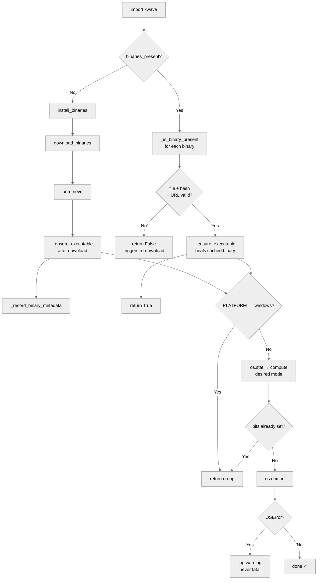

# Issue

**Title:** Set exec bit on Linux/macOS binaries after download

## Description

## Summary

After `urlretrieve` downloads the C++ binary, set the executable bit on Linux/macOS so the C++ backend can actually invoke it.

## Why this was latent

Most users have hit `_is_binary_present` from a prior install where pip/wheel extraction set the bit, so the broken \`urlretrieve\` path wasn't exercised. Surfaced on a clean Colab install when validating v1.4.0:

\`\`\`
\$ kspaceFirstOrder-CUDA --version
bash: kspaceFirstOrder-CUDA: Permission denied
exit=126
\`\`\`

\`ls -l\` showed \`-rw-r--r--\`.

## Change

In \`kwave/__init__.py\` \`download_binaries\`, after \`urlretrieve\`, OR-in the user/group/other exec bits on non-Windows platforms.

## Test plan

- [x] Pre-commit clean (ruff + format + codespell)
- [ ] CI: clean install on Linux + macOS runners should now produce an executable binary
- [ ] Manual: on Colab, after \`pip install\` from this branch, \`ls -l\` of the downloaded binary shows the exec bit set

🤖 Generated with [Claude Code](https://claude.com/claude-code)

<!-- greptile_comment -->

<h3>Greptile Summary</h3>

This PR fixes a latent bug where `urlretrieve` downloads binaries with 0644 permissions, causing `Permission denied` (exit 126) when the C++ backend tries to invoke them on Linux/macOS. A new `_ensure_executable` helper ORs in the user/group/other execute bits and is called both after fresh downloads and during cache-hit validation in `_is_binary_present`, so existing installations are self-healed at import time.

- **`_ensure_executable`** uses `os.stat` + `os.chmod` guarded by a broad `except OSError` that degrades to a warning rather than aborting `import kwave`.
- **`_is_binary_present`** now calls `_ensure_executable` before returning `True`, healing cached non-executable binaries on the next `import kwave` without requiring a re-download.
- **Tests** add two regression scenarios (`test_download_sets_executable_bit`, `test_existing_non_executable_binary_is_healed`) using a `next(urls[0] for … if urls)` pattern that safely skips the empty `darwin["cuda"]` list.

<h3>Confidence Score: 5/5</h3>

Safe to merge — the change is narrowly scoped, correctly heals both fresh-download and cached-binary paths, and degrades gracefully on read-only filesystems.

The `_ensure_executable` helper is called in both the download and cache-hit paths, ensuring all users are covered at the next `import kwave`. The `except OSError` catch is broad enough to handle read-only mounts and wrong-ownership scenarios without aborting the import. Tests cover both code paths with proper platform guards and the `if urls` filter that prevents an `IndexError` on macOS where the CUDA URL list is empty.

No files require special attention.

<h3>Important Files Changed</h3>

| Filename | Overview |
|----------|----------|
| kwave/__init__.py | Adds `_ensure_executable` (OSError-safe chmod) and calls it in both `download_binaries` and `_is_binary_present`, correctly healing both fresh downloads and cached binaries at import time. |
| tests/test__init__.py | Adds two well-structured regression tests (download path and cache-hit healing) with `if urls` guard that safely handles the empty `darwin["cuda"]` list; also fixes existing `test__init` to restore module state after a reload-based exception test. |

<h3>Flowchart</h3>

<!-- greptile_failed_comments -->

<h3>Comments Outside Diff (1)</h3>

1. `kwave/__init__.py`, line 81-112 ([link](https://github.com/waltsims/k-wave-python/blob/2a327f34010f06d89f98b30706f1842b7c585686/kwave/__init__.py#L81-L112))

    **Existing broken installations won't be healed**

   `_is_binary_present` returns `True` for a binary that is already on disk with a valid hash and matching URL — it never checks the executable bit. A user whose binary was downloaded before this fix (or whose pip install produced the binary without the exec bit) will have `binaries_present()` return `True`, so `install_binaries` is skipped and the `chmod` added in this PR never runs for them. Their `Permission denied` error persists across upgrades.

<!-- /greptile_failed_comments -->

Reviews (9): Last reviewed commit:  | [Re-trigger Greptile](https://app.greptile.com/api/retrigger?id=32513077)

<!-- /greptile_comment -->

## Task

Modify the repository so that the issue described above is resolved. The repository is checked out at base commit `21f452180cdb`. Edit files in place; the verifier captures your changes via `git diff` and scores them against an oracle patch using SWE-RL-style diff-similarity reward.