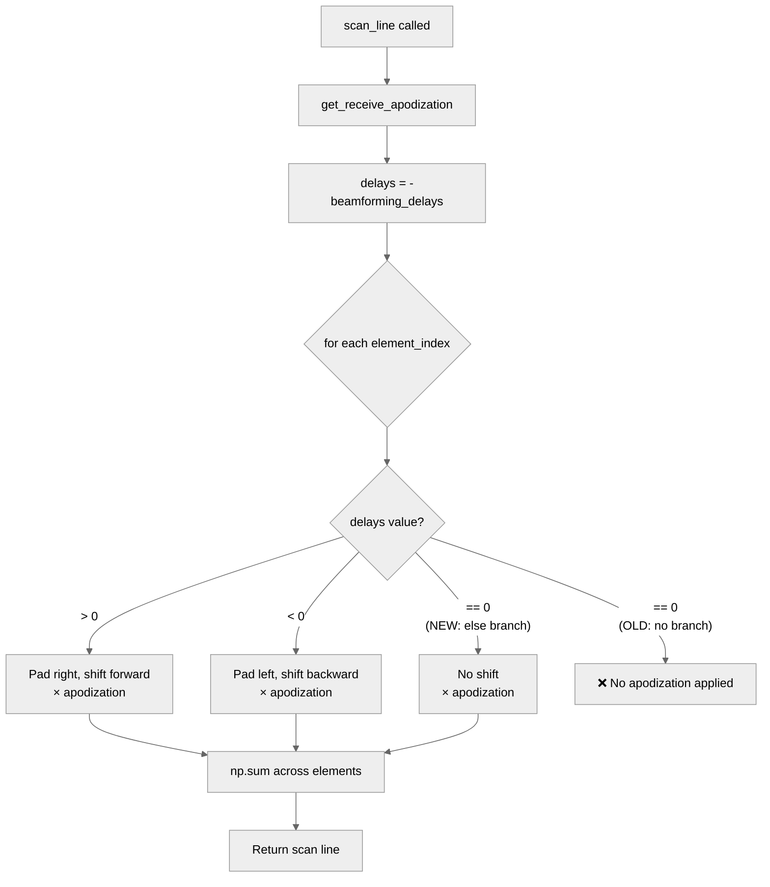

# Issue

**Title:** fix: apply apodization when delay is zero in scan_line

## Description

The `scan_line` method in `NotATransducer` only applied apodization weights when `delay != 0`, silently skipping elements with `delay == 0`. This meant those elements contributed to the summed line without their receive apodization weight.

Added an `else` branch to apply apodization for all active elements regardless of delay value.

```python
# Before: elements with delay==0 skipped apodization entirely
if delays[element_index] > 0:
    ...
elif delays[element_index] < 0:
    ...
# delay == 0 → no apodization applied ❌

# After:
else:
    # No delay — still apply apodization weight
    sensor_data[element_index, :] *= apodization[element_index]
```

<!-- greptile_comment -->

<h3>Greptile Summary</h3>

This PR fixes a silent beamforming bug in `NotATransducer.scan_line` where elements whose delay rounded to exactly zero were summed into the output line without having their receive apodization weight applied. The fix is a minimal, correct `else` branch that mirrors the apodization multiply already present in the `> 0` and `< 0` branches.

- The impact is most pronounced when `steering_angle == 0` and `focus_distance == inf`, where every element's delay is zero — meaning the old code applied **no** apodization at all for that common B-mode configuration.
- The single-line change is tightly scoped and does not affect any other code path.

<h3>Confidence Score: 5/5</h3>

Safe to merge — the change closes a well-defined gap where zero-delay elements skipped apodization entirely.

The three-line addition completes a pattern that is already correct in the adjacent branches, and the failure scenario (unweighted elements contributing to the summed line) is clearly reproduced whenever all delays are zero, which is the default no-steering/no-focus case.

No files require special attention.

<details><summary><h3>Important Files Changed</h3></summary>

| Filename | Overview |
|----------|----------|
| kwave/ktransducer.py | Adds `else` branch to `scan_line` so apodization is applied to elements whose beamforming delay rounds to zero, fixing a silent bug where those elements contributed unweighted signal to the summed line. |

</details>

</details>

<h3>Flowchart</h3>



<sub>Reviews (1): Last reviewed commit:  | [Re-trigger Greptile](https://app.greptile.com/api/retrigger?id=32557363)</sub>

<!-- /greptile_comment -->

## Task

Modify the repository so that the issue described above is resolved. The repository is checked out at base commit `0ba78768640f`. Edit files in place; the verifier captures your changes via `git diff` and scores them against an oracle patch using SWE-RL-style diff-similarity reward.