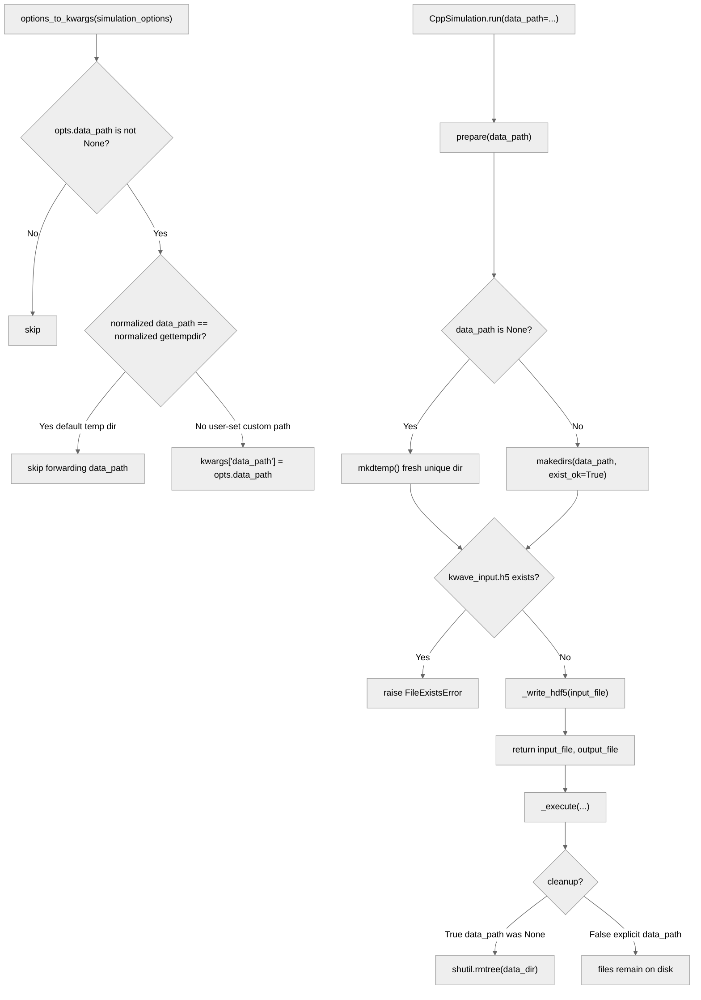

# Issue

**Title:** fix: prevent HDF5 dataset collision when data_path is reused

## Description

## Summary

- `options_to_kwargs()` was always forwarding `data_path='/tmp'` (the `SimulationOptions` default), bypassing the safe `mkdtemp` path in `prepare()` and causing h5py to crash with `ValueError: name already exists` on any second run
- `compat.py`: skip forwarding `data_path` when it equals `gettempdir()`, so `prepare()` falls back to a fresh unique temp dir per run
- `cpp_simulation.py`: raise `FileExistsError` with a clear message when an explicit `data_path` already contains `kwave_input.h5`

## Test plan

- [ ] `test_default_data_path_not_forwarded` — asserts `data_path` is not forwarded when using default `SimulationOptions()` (would have failed before fix)
- [ ] `test_custom_data_path_is_forwarded` — asserts an explicitly-set `data_path` is still forwarded correctly
- [ ] `test_raises_when_input_already_exists` — asserts `prepare()` raises `FileExistsError` with a clear message when the input file already exists (would have failed before fix)

<!-- greptile_comment -->

<h3>Greptile Summary</h3>

This PR fixes a `ValueError: name already exists` crash from h5py that occurred on any second simulation run, caused by `options_to_kwargs()` always forwarding the default `data_path=gettempdir()` and bypassing the `mkdtemp`-based unique-directory logic in `prepare()`.

- **`kwave/compat.py`**: Uses normalized `os.path.realpath` comparison to skip forwarding `data_path` when it holds the system temp dir default, allowing `prepare()` to fall back to a fresh `mkdtemp` directory per run.
- **`kwave/solvers/cpp_simulation.py`**: Adds an early `FileExistsError` guard in `prepare()` so that an explicit `data_path` reuse produces a clear, actionable error instead of a cryptic h5py exception.
- **Tests**: Three regression tests are added covering: default path not forwarded, custom path forwarded, and `FileExistsError` on collision.

<h3>Confidence Score: 5/5</h3>

Safe to merge — the fix correctly targets the default-path collision scenario and does not regress explicit data_path forwarding.

Both changed code paths are straightforward: the compat guard uses realpath+normpath normalization which handles platform symlink differences (e.g. macOS /tmp → /private/tmp), and the FileExistsError guard in prepare() only fires for explicit data_path values (mkdtemp always produces a new empty directory). All three new test cases directly cover the fixed scenarios. No new defects were found beyond style observations.

kwave/compat.py — the import placement is unusual but purely cosmetic. No files require attention for correctness.

<h3>Important Files Changed</h3>

| Filename | Overview |
|----------|----------|
| kwave/compat.py | Adds normalized path comparison to skip forwarding data_path when it equals the system temp dir; imports os and gettempdir inside the conditional block rather than at module level |
| kwave/solvers/cpp_simulation.py | Adds FileExistsError guard in prepare() before _write_hdf5(); also reformats a long _execute() call to multi-line for readability |
| tests/test_compat.py | Adds two regression tests: verifies default data_path is not forwarded, and explicitly-set data_path is forwarded |
| tests/test_cpp_simulation.py | Adds TestPrepare class with a test verifying FileExistsError is raised when kwave_input.h5 already exists |

<h3>Flowchart</h3>

Reviews (2): Last reviewed commit:  | [Re-trigger Greptile](https://app.greptile.com/api/retrigger?id=32656875)

<!-- /greptile_comment -->

## Task

Modify the repository so that the issue described above is resolved. The repository is checked out at base commit `4177811a1e23`. Edit files in place; the verifier captures your changes via `git diff` and scores them against an oracle patch using SWE-RL-style diff-similarity reward.