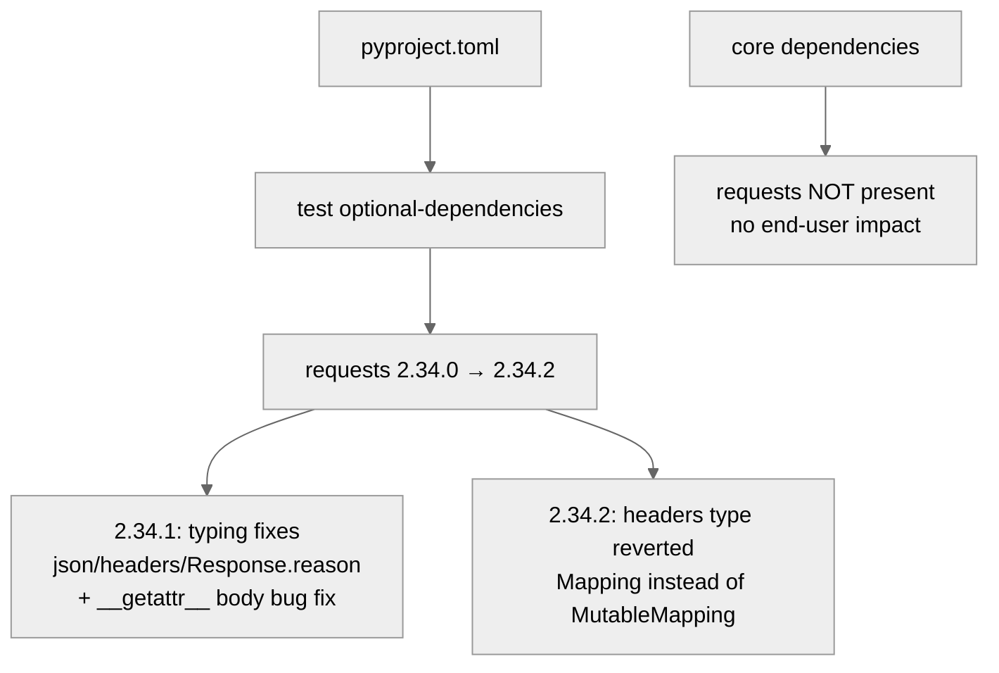

# Issue

**Title:** Bump requests from 2.34.0 to 2.34.2

## Description

Bumps [requests](https://github.com/psf/requests) from 2.34.0 to 2.34.2.

Release notes

<em>Sourced from <a href="https://github.com/psf/requests/releases">requests's releases</a>.</em>

<blockquote>
<h2>v2.34.2</h2>
<h2>2.34.2 (2026-05-14)</h2>
<ul>
<li>Moved <code>headers</code> input type back to <code>Mapping</code> to avoid invariance issues with <code>MutableMapping</code> and inferred dict types. Users calling <code>Request.headers.update()</code> may need to narrow typing in their code. (<a href="">#7441</a>)</li>
</ul>

<strong>Full Changelog</strong>: <a href="https://github.com/psf/requests/blob/main/HISTORY.md#2342-2026-05-14">https://github.com/psf/requests/blob/main/HISTORY.md#2342-2026-05-14</a>

<h2>v2.34.1</h2>
<h2>2.34.1 (2026-05-13)</h2>

<strong>Bugfixes</strong>

<ul>
<li>Widened <code>json</code> input type from <code>dict</code> and <code>list</code> to <code>Mapping</code>
and <code>Sequence</code>. (<a href="">#7436</a>)</li>
<li>Changed <code>headers</code> input type to MutableMapping and removed <code>None</code> from
<code>Request.headers</code> typing to improve handling for users. (<a href="">#7431</a>)</li>
<li><code>Response.reason</code> moved from <code>str | None</code> to <code>str</code> to improve handling
for users. (<a href="">#7437</a>)</li>
<li>Fixed a bug where some bodies with custom <code>__getattr__</code> implementations
weren't being properly detected as Iterables. (<a href="">#7433</a>)</li>
</ul>
<h2>New Contributors</h2>
<ul>
<li><a href="https://github.com/k223kim"><code>@​k223kim</code></a> made their first contribution in <a href="">psf/requests#7433</a></li>
</ul>

<strong>Full Changelog</strong>: <a href="https://github.com/psf/requests/blob/main/HISTORY.md#2341-2026-05-13">https://github.com/psf/requests/blob/main/HISTORY.md#2341-2026-05-13</a>

</blockquote>

Changelog

<em>Sourced from <a href="https://github.com/psf/requests/blob/main/HISTORY.md">requests's changelog</a>.</em>

<blockquote>
<h2>2.34.2 (2026-05-14)</h2>
<ul>
<li>Moved <code>headers</code> input type back to <code>Mapping</code> to avoid invariance issues
with <code>MutableMapping</code> and inferred dict types. Users calling
<code>Request.headers.update()</code> may need to narrow typing in their code. (<a href="">#7441</a>)</li>
</ul>
<h2>2.34.1 (2026-05-13)</h2>

<strong>Bugfixes</strong>

<ul>
<li>Widened <code>json</code> input type from <code>dict</code> and <code>list</code> to <code>Mapping</code>
and <code>Sequence</code>. (<a href="">#7436</a>)</li>
<li>Changed <code>headers</code> input type to MutableMapping and removed <code>None</code> from
<code>Request.headers</code> typing to improve handling for users. (<a href="">#7431</a>)</li>
<li><code>Response.reason</code> moved from <code>str | None</code> to <code>str</code> to improve handling
for users. (<a href="">#7437</a>)</li>
<li>Fixed a bug where some bodies with custom <code>__getattr__</code> implementations
weren't being properly detected as Iterables. (<a href="">#7433</a>)</li>
</ul>
</blockquote>

Commits

<ul>
<li><a href=""><code>6e83187</code></a> v2.34.2</li>
<li><a href=""><code>84d10f0</code></a> Move Request.headers back to Mapping (<a href="">#7441</a>)</li>
<li><a href=""><code>b7b549b</code></a> v2.34.1</li>
<li><a href=""><code>e511bc7</code></a> Fix mutability issues with headers input types (<a href="">#7431</a>)</li>
<li><a href=""><code>5691f59</code></a> Update JsonType containers to read-based collections (<a href="">#7436</a>)</li>
<li><a href=""><code>2144213</code></a> Constrain Response.reason to str (<a href="">#7437</a>)</li>
<li><a href=""><code>6404f34</code></a> Fix <code>prepare_body</code> stream detection for <code>__getattr__</code>-based file wrappers (<a href="">#7</a>...</li>
<li>See full diff in <a href="https://github.com/psf/requests/compare/v2.34.0...v2.34.2">compare view</a></li>
</ul>

 

Dependabot will resolve any conflicts with this PR as long as you don't alter it yourself. You can also trigger a rebase manually by commenting `@dependabot rebase`.

[//]: # (dependabot-automerge-start)
[//]: # (dependabot-automerge-end)

---

Dependabot commands and options

 

You can trigger Dependabot actions by commenting on this PR:
- `@dependabot rebase` will rebase this PR
- `@dependabot recreate` will recreate this PR, overwriting any edits that have been made to it
- `@dependabot show <dependency name> ignore conditions` will show all of the ignore conditions of the specified dependency
- `@dependabot ignore this major version` will close this PR and stop Dependabot creating any more for this major version (unless you reopen the PR or upgrade to it yourself)
- `@dependabot ignore this minor version` will close this PR and stop Dependabot creating any more for this minor version (unless you reopen the PR or upgrade to it yourself)
- `@dependabot ignore this dependency` will close this PR and stop Dependabot creating any more for this dependency (unless you reopen the PR or upgrade to it yourself)

<!-- greptile_comment -->

<h3>Greptile Summary</h3>

This PR bumps the `requests` library from 2.34.0 to 2.34.2 in the test optional dependencies. The two patch releases are purely bugfix/typing improvements with no breaking changes.

- Versions 2.34.1 and 2.34.2 address typing fixes (`json`, `headers`, `Response.reason`) and a runtime bug where bodies with custom `__getattr__` implementations weren't correctly detected as iterables — none of these affect k-wave-python's test usage of `requests`.
- `requests` is pinned only under `[project.optional-dependencies].test`, so end-users and production installs are unaffected.

<h3>Confidence Score: 5/5</h3>

Safe to merge — single-line patch version bump in test-only dependencies with no runtime or API impact.

The change touches only the test extras group and both patch releases contain bug fixes and typing improvements with no breaking changes. The library is not part of the published package's runtime dependencies, so no downstream users are affected.

No files require special attention.

<h3>Important Files Changed</h3>

| Filename | Overview |
|----------|----------|
| pyproject.toml | Bumps `requests` from 2.34.0 to 2.34.2 in the test optional-dependencies group; no other changes. |

<h3>Flowchart</h3>

Reviews (1): Last reviewed commit:  | [Re-trigger Greptile](https://app.greptile.com/api/retrigger?id=32753893)

<!-- /greptile_comment -->

## Task

Modify the repository so that the issue described above is resolved. The repository is checked out at base commit `d500015acd1c`. Edit files in place; the verifier captures your changes via `git diff` and scores them against an oracle patch using SWE-RL-style diff-similarity reward.