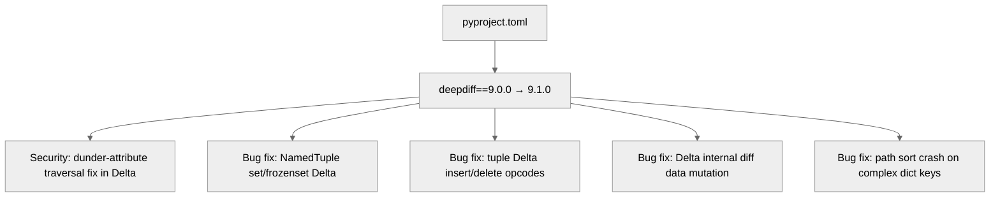

# Issue

**Title:** Bump deepdiff from 9.0.0 to 9.1.0

## Description

Bumps [deepdiff](https://github.com/qlustered/deepdiff) from 9.0.0 to 9.1.0.

Commits

<ul>
<li>See full diff in <a href="https://github.com/qlustered/deepdiff/commits">compare view</a></li>
</ul>

 

Dependabot will resolve any conflicts with this PR as long as you don't alter it yourself. You can also trigger a rebase manually by commenting `@dependabot rebase`.

[//]: # (dependabot-automerge-start)
[//]: # (dependabot-automerge-end)

---

Dependabot commands and options

 

You can trigger Dependabot actions by commenting on this PR:
- `@dependabot rebase` will rebase this PR
- `@dependabot recreate` will recreate this PR, overwriting any edits that have been made to it
- `@dependabot show <dependency name> ignore conditions` will show all of the ignore conditions of the specified dependency
- `@dependabot ignore this major version` will close this PR and stop Dependabot creating any more for this major version (unless you reopen the PR or upgrade to it yourself)
- `@dependabot ignore this minor version` will close this PR and stop Dependabot creating any more for this minor version (unless you reopen the PR or upgrade to it yourself)
- `@dependabot ignore this dependency` will close this PR and stop Dependabot creating any more for this dependency (unless you reopen the PR or upgrade to it yourself)

<!-- greptile_comment -->

<h3>Greptile Summary</h3>

This PR bumps `deepdiff` from `9.0.0` to `9.1.0` in `pyproject.toml`. The new release is a patch-level update containing several bug fixes and a notable security hardening in the `Delta` component.

- **Security fix**: Delta's `check_elem()` now raises immediately on dunder-attribute traversal attempts instead of routing through `_raise_or_log()`, and full-path preflight validation was added so malicious dunder paths can no longer be silently skipped via the `set_item_added` code path.
- **Bug fixes**: Corrects nested `NamedTuple` set/frozenset Delta updates dropping the outer container, tuple Deltas silently no-oping for insert/delete-only changes, Delta mutations of internal diff data, and a crash when sorting paths with complex dictionary keys.

<h3>Confidence Score: 5/5</h3>

Safe to merge — single-line version bump with no behavioral changes to the project itself.

The only change is pinning `deepdiff` to `9.1.0`, which brings a security hardening and several Delta bug fixes with no breaking API changes. The update follows the project's established exact-version pinning convention and poses no regression risk to k-wave-python's own code.

No files require special attention.

<h3>Important Files Changed</h3>

| Filename | Overview |
|----------|----------|
| pyproject.toml | Bumps `deepdiff` from 9.0.0 to 9.1.0; single-line change, consistent with the project's exact-version pinning pattern. |

<h3>Flowchart</h3>

Reviews (1): Last reviewed commit:  | [Re-trigger Greptile](https://app.greptile.com/api/retrigger?id=32753901)

<!-- /greptile_comment -->

## Task

Modify the repository so that the issue described above is resolved. The repository is checked out at base commit `d500015acd1c`. Edit files in place; the verifier captures your changes via `git diff` and scores them against an oracle patch using SWE-RL-style diff-similarity reward.