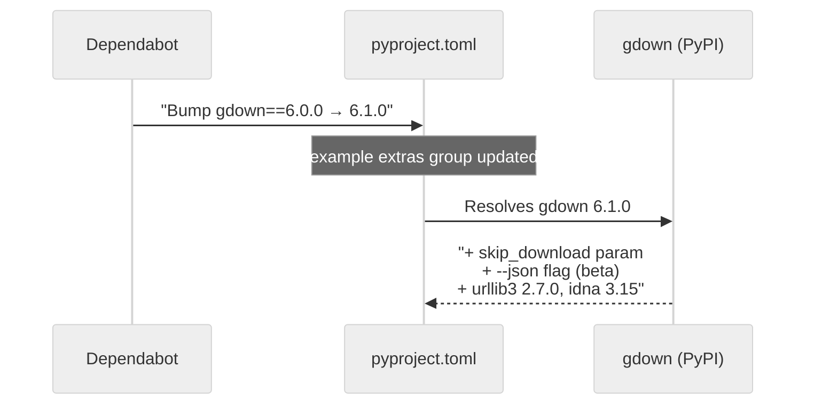
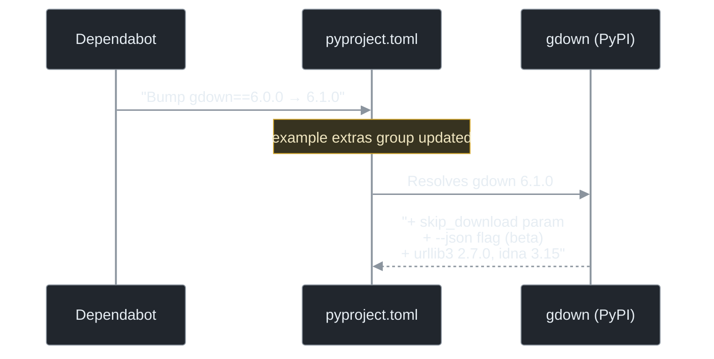

# Issue

**Title:** Bump gdown from 6.0.0 to 6.1.0

## Description

Bumps [gdown](https://github.com/wkentaro/gdown) from 6.0.0 to 6.1.0.

Release notes

<em>Sourced from <a href="https://github.com/wkentaro/gdown/releases">gdown's releases</a>.</em>

<blockquote>
<h2>v6.1.0</h2>

This release adds a new <code>--json</code> flag for inspecting Google Drive file and folder contents without downloading them.

<h3>Highlights</h3>
<ul>
<li>New <code>--json</code> flag lists the file or folder contents as a JSON array on stdout instead of downloading, so you can resolve filenames and IDs before fetching anything. It is in beta and its output format may change in a future release.</li>
</ul>
<h3>Features</h3>
<ul>
<li>

Add a <code>--json</code> flag that prints file or folder contents as a JSON array of <code>{&quot;url&quot;, &quot;path&quot;}</code> entries instead of downloading. Paths use POSIX separators on all platforms, and the flag cannot be combined with <code>-O/--output</code>. (<a href="">#460</a>, <a href="">#463</a>)

<pre lang="bash"><code># Resolve a single file's name without downloading it
filename=$(gdown &quot;$url&quot; --json | jq -r '.[0].path')
<h1>List every file in a folder</h1>

gdown <a href="https://drive.google.com/drive/folders/FOLDER_ID">https://drive.google.com/drive/folders/FOLDER_ID</a> --folder --json
</code></pre>

</li>
<li>

Add a <code>skip_download</code> parameter to <code>download()</code> that resolves the target filename and ID without fetching the file, returning a <code>GoogleDriveFileToDownload</code>. (<a href="">#463</a>)

</li>
<li>

<code>--json</code> now prints a one-time beta warning to stderr, which <code>--quiet</code> suppresses. (<a href="">#465</a>)

</li>
</ul>
<h3>Other</h3>
<ul>
<li>Bump <code>urllib3</code> from 2.6.3 to 2.7.0. (<a href="">#457</a>)</li>
<li>Bump <code>idna</code> from 3.11 to 3.15. (<a href="">#459</a>)</li>
<li>Configure agent skills for the repository (<code>AGENTS.md</code>, <code>CLAUDE.md</code>, <code>docs/agents/</code>). (<a href="">#462</a>)</li>
</ul>
</blockquote>

Commits

<ul>
<li><a href=""><code>fba3f9a</code></a> Merge pull request <a href="">#465</a> from wkentaro/feat/json-beta-warning</li>
<li><a href=""><code>d91a180</code></a> feat(cli): mark --json as beta with a suppressible warning</li>
<li><a href=""><code>be400b6</code></a> Merge pull request <a href="">#464</a> from wkentaro/docs/json-readme-ext</li>
<li><a href=""><code>3466fbb</code></a> docs: simplify --json extension example with shell expansion</li>
<li><a href=""><code>eaef5a1</code></a> Merge pull request <a href="">#463</a> from wkentaro/feat/json-single-file</li>
<li><a href=""><code>5ae36fc</code></a> docs: correct download() return type in ADR and CONTEXT</li>
<li><a href=""><code>057f7ff</code></a> test(download): assert skip_download returns GoogleDriveFileToDownload</li>
<li><a href=""><code>7764313</code></a> docs: document single-file --json and capture design decisions</li>
<li><a href=""><code>6597898</code></a> feat(cli): support --json for single files</li>
<li><a href=""><code>61181bd</code></a> feat(download): add skip_download to resolve filename without downloading</li>
<li>Additional commits viewable in <a href="https://github.com/wkentaro/gdown/compare/v6.0.0...v6.1.0">compare view</a></li>
</ul>

 

Dependabot will resolve any conflicts with this PR as long as you don't alter it yourself. You can also trigger a rebase manually by commenting `@dependabot rebase`.

[//]: # (dependabot-automerge-start)
[//]: # (dependabot-automerge-end)

---

Dependabot commands and options

 

You can trigger Dependabot actions by commenting on this PR:
- `@dependabot rebase` will rebase this PR
- `@dependabot recreate` will recreate this PR, overwriting any edits that have been made to it
- `@dependabot show <dependency name> ignore conditions` will show all of the ignore conditions of the specified dependency
- `@dependabot ignore this major version` will close this PR and stop Dependabot creating any more for this major version (unless you reopen the PR or upgrade to it yourself)
- `@dependabot ignore this minor version` will close this PR and stop Dependabot creating any more for this minor version (unless you reopen the PR or upgrade to it yourself)
- `@dependabot ignore this dependency` will close this PR and stop Dependabot creating any more for this dependency (unless you reopen the PR or upgrade to it yourself)

<!-- greptile_comment -->

<h3>Greptile Summary</h3>

Bumps the `gdown` dependency from 6.0.0 to 6.1.0 in the `example` extras group of `pyproject.toml`. This is a minor version bump that adds a new `--json` inspection flag and a `skip_download` parameter to `download()`, with no breaking changes to existing APIs.

- The only file changed is `pyproject.toml`, pinning `gdown==6.1.0` in the `example` dependency group.
- The new version also bumps transitive dependencies (`urllib3` 2.6.3→2.7.0, `idna` 3.11→3.15) which are security-maintenance updates.

<h3>Confidence Score: 5/5</h3>

Safe to merge — single-line version pin bump in an optional extras group with a purely additive minor release.

gdown 6.1.0 is a backward-compatible minor release that only adds new optional features (`--json` flag, `skip_download` parameter) and bumps two transitive dependencies for security maintenance. No existing API is changed or removed, and the dependency lives only in the `example` extras group so it does not affect core library users.

No files require special attention.

<h3>Important Files Changed</h3>

| Filename | Overview |
|----------|----------|
| pyproject.toml | Single-line version bump of gdown from 6.0.0 to 6.1.0 in the `example` extras group; additive-only minor release with no breaking changes. |

<h3>Sequence Diagram</h3>

Reviews (2): Last reviewed commit:  | [Re-trigger Greptile](https://app.greptile.com/api/retrigger?id=35336891)

<!-- /greptile_comment -->

## Task

Modify the repository so that the issue described above is resolved. The repository is checked out at base commit `72dd9d13b501`. Edit files in place; the verifier captures your changes via `git diff` and scores them against an oracle patch using SWE-RL-style diff-similarity reward.