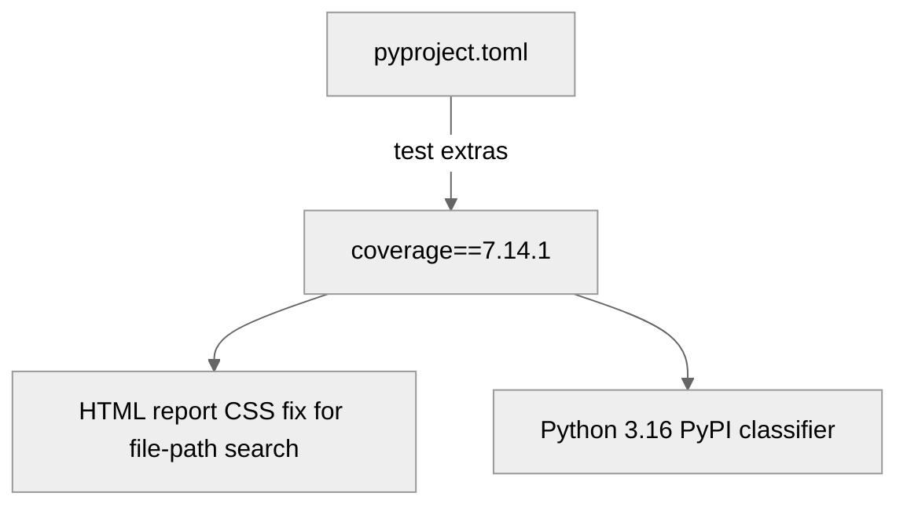

# Issue

**Title:** Bump coverage from 7.14.0 to 7.14.1

## Description

Bumps [coverage](https://github.com/coveragepy/coveragepy) from 7.14.0 to 7.14.1.

Changelog

<em>Sourced from <a href="https://github.com/coveragepy/coveragepy/blob/main/CHANGES.rst">coverage's changelog</a>.</em>

<blockquote>
<h2>Version 7.14.1 — 2026-05-26</h2>
<ul>
<li>

Fix: the HTML report used typographic niceties to make file paths more
readable by adding a small amount of space around slashes. Those spaces
interfered with searching the page for file paths of interest. Now the report
uses CSS to accomplish the same visual tweak so that searches with slashes
work correctly. Closes <code>issue 2170</code>_.

</li>
<li>

<code>Add a 3.16 PyPI classifier &lt;hugo-316_&gt;</code>_ since we test on the 3.16 main
branch.

</li>
</ul>

.. _issue 2170: <a href="">coveragepy/coveragepy#2170</a>
.. _hugo-316: <a href="https://mastodon.social/@hugovk/116588523571204490">https://mastodon.social/@​hugovk/116588523571204490</a>

.. _changes_7-14-0:

</blockquote>

Commits

<ul>
<li><a href=""><code>64d9b66</code></a> docs: correct the date for 7.14.1</li>
<li><a href=""><code>6fa7dd4</code></a> chore: bump actions/dependency-review-action (<a href="">#2181</a>)</li>
<li><a href=""><code>078afae</code></a> docs: sample HTML for 7.14.1</li>
<li><a href=""><code>cb4f028</code></a> docs: prep for 7.14.1</li>
<li><a href=""><code>ae2d09f</code></a> Merge branch 'nedbat/classifire-316-kits'</li>
<li><a href=""><code>2c3568b</code></a> build: declare 3.16 compatibility</li>
<li><a href=""><code>faa68f8</code></a> chore: bump github/codeql-action in the action-dependencies group (<a href="">#2173</a>)</li>
<li><a href=""><code>eb55fee</code></a> test: we don't need PyPy &lt; 7.3.22 anymore</li>
<li><a href=""><code>ac168fe</code></a> test: the text summary should show missing</li>
<li><a href=""><code>fed4bd2</code></a> chore: upgrade virtualenv</li>
<li>Additional commits viewable in <a href="https://github.com/coveragepy/coveragepy/compare/7.14.0...7.14.1">compare view</a></li>
</ul>

 

Dependabot will resolve any conflicts with this PR as long as you don't alter it yourself. You can also trigger a rebase manually by commenting `@dependabot rebase`.

[//]: # (dependabot-automerge-start)
[//]: # (dependabot-automerge-end)

---

Dependabot commands and options

 

You can trigger Dependabot actions by commenting on this PR:
- `@dependabot rebase` will rebase this PR
- `@dependabot recreate` will recreate this PR, overwriting any edits that have been made to it
- `@dependabot show <dependency name> ignore conditions` will show all of the ignore conditions of the specified dependency
- `@dependabot ignore this major version` will close this PR and stop Dependabot creating any more for this major version (unless you reopen the PR or upgrade to it yourself)
- `@dependabot ignore this minor version` will close this PR and stop Dependabot creating any more for this minor version (unless you reopen the PR or upgrade to it yourself)
- `@dependabot ignore this dependency` will close this PR and stop Dependabot creating any more for this dependency (unless you reopen the PR or upgrade to it yourself)

<!-- greptile_comment -->

<h3>Greptile Summary</h3>

This PR bumps the pinned `coverage` test dependency from 7.14.0 to 7.14.1, a patch release that fixes an HTML report search regression and adds a Python 3.16 PyPI classifier.

- The only change is a single version string in `pyproject.toml`; no application or test logic is modified.
- The 7.14.1 release contains only a CSS fix for file-path search in HTML reports and a metadata classifier addition, so there is no behavioral risk to the test suite.

<h3>Confidence Score: 5/5</h3>

Safe to merge — a single-line patch-version bump to a dev-only test tool with no runtime impact.

The change is a one-line update to a pinned version of coverage, used only in the test extras. The 7.14.1 release contains only a CSS tweak in the HTML reporter and a PyPI metadata classifier; neither affects how coverage collects or reports data during CI runs.

No files require special attention.

<h3>Important Files Changed</h3>

| Filename | Overview |
|----------|----------|
| pyproject.toml | Bumps the pinned `coverage` dev dependency from 7.14.0 to 7.14.1 — a pure patch-level version bump with no logic changes. |

<h3>Flowchart</h3>

Reviews (1): Last reviewed commit:  | [Re-trigger Greptile](https://app.greptile.com/api/retrigger?id=35336909)

<!-- /greptile_comment -->

## Task

Modify the repository so that the issue described above is resolved. The repository is checked out at base commit `66c256de439b`. Edit files in place; the verifier captures your changes via `git diff` and scores them against an oracle patch using SWE-RL-style diff-similarity reward.