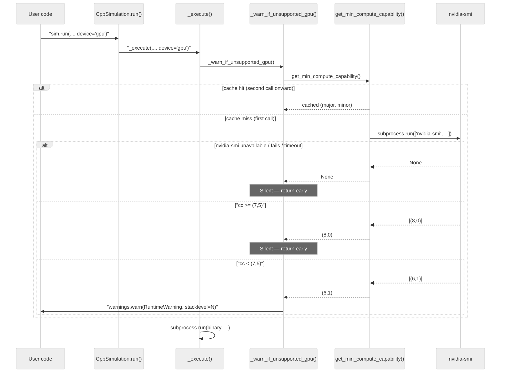
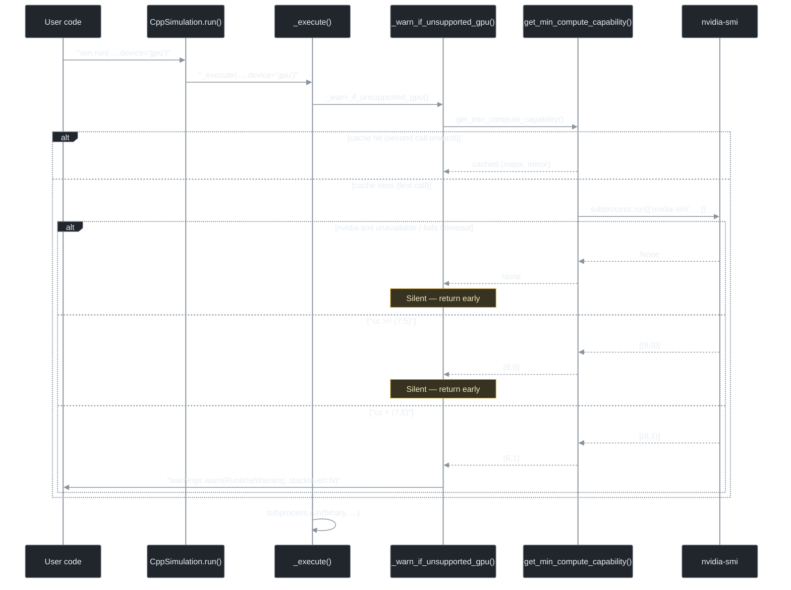

# Issue

**Title:** Warn at runtime when GPU compute capability < 7.5

## Description

## Summary

When a user runs k-wave-python with `backend=\"cpp\"` and `device=\"gpu\"` on a GPU older than Turing (Maxwell, Pascal, Volta — compute capability < 7.5), the bundled CUDA binary fails with the cryptic message:

> no kernel image is available for execution on the device

This is because CUDA Toolkit 13.0 (used to build the v1.4.x binaries) dropped support for `sm_5x`, `sm_6x`, and `sm_70`. The binary contains no kernel images for those architectures.

This PR adds a one-shot lazy check that shells out to `nvidia-smi --query-gpu=compute_cap --format=csv,noheader,nounits`, parses the lowest visible compute capability, caches it, and emits a `RuntimeWarning` before invoking the binary if any GPU is below 7.5. The warning text points users at the two viable workarounds: switch to `backend=\"python\"` (NumPy/CuPy works on every CUDA-capable GPU), or build the C++ backend from source with CUDA Toolkit 12.x.

## When it fires

The warning fires **only** when **all three** of the following are true:

1. The C++ backend is being executed (`CppSimulation._execute`)
2. `device=\"gpu\"` is requested
3. `nvidia-smi` is available, runs successfully, and reports at least one GPU with compute capability `< 7.5`

It is **silent** when:
- `device=\"cpu\"` (OMP binary — Maxwell/Pascal/Volta restriction is CUDA-only)
- `nvidia-smi` is unavailable, times out, or returns unparseable output (the user may have a custom CUDA setup, or the binary may JIT from PTX)
- All visible GPUs have compute capability `>= 7.5`

It is a `RuntimeWarning` — execution proceeds. The warning is the deliverable; the user decides whether to switch backends.

## Implementation

- New module `kwave/utils/cuda.py` with `get_min_compute_capability()` — module-level cached after first call so multi-step simulations don't re-shell `nvidia-smi`.
- `CppSimulation._warn_if_unsupported_gpu()` consults the helper and emits the warning. Called from `_execute()` only when `device == \"gpu\"`.

## Test plan

New test file `tests/test_compute_capability_warning.py` covers:

- [x] `get_min_compute_capability` returns parsed value for single GPU
- [x] Returns the **minimum** across multiple GPUs
- [x] Returns `None` when `nvidia-smi` is not on PATH
- [x] Returns `None` when `nvidia-smi` exits non-zero
- [x] Returns `None` on `TimeoutExpired`
- [x] Returns `None` on `OSError`
- [x] Returns `None` on empty / unparseable output
- [x] Result is cached (subprocess.run called once across 3 invocations)
- [x] `RuntimeWarning` fires when `_execute(device=\"gpu\")` and cc < 7.5
- [x] Warning text mentions Maxwell, Pascal, **and** Volta (and suggests `backend='python'`)
- [x] Warning does **not** fire when cc >= 7.5
- [x] Warning does **not** fire when `nvidia-smi` returns `None`
- [x] Warning does **not** fire when `device=\"cpu\"` (helper is not even called)

All 14 new tests + 10 existing `tests/test_cpp_simulation.py` tests pass:

\`\`\`
24 passed in 2.00s
\`\`\`

## Related

- Pairs with the kspacefirstorder-unified arch-list expansion work (see in-flight PR on the binary repo) — that PR fixes the build for sm 7.5+ via CUDA 13.0; this PR provides the diagnostic for users below that floor.
- Complements the README migration note added in #750.

<!-- greptile_comment -->

<h3>Greptile Summary</h3>

This PR adds a one-shot, lazily-cached runtime warning that fires before the C++ binary is invoked when `device="gpu"` is requested and `nvidia-smi` reports a GPU with compute capability below 7.5 (the floor imposed by CUDA Toolkit 13.0, which dropped Maxwell/Pascal/Volta support).

- **`kwave/utils/cuda.py`** (new): `_query_nvidia_smi()` shells out to `nvidia-smi` and parses per-GPU compute capabilities; `get_min_compute_capability()` wraps it with module-level caching protected by a `threading.Lock` and double-checked locking; `user_warning_stacklevel()` walks `sys._getframe` upward past all kwave-internal frames so `warnings.warn` attributes to the caller's code regardless of whether the entry point is `run()` or `_execute()` directly.
- **`kwave/solvers/cpp_simulation.py`**: Adds `_warn_if_unsupported_gpu()` static method (called only on `device="gpu"`) and the `_MIN_SUPPORTED_COMPUTE_CAPABILITY = (7, 5)` constant.
- **`tests/test_compute_capability_warning.py`**: 13 new tests covering happy path, min-across-GPUs, all failure modes, caching (run once), warning text content, and the no-fire cases (`cpu`, supported GPU, unavailable `nvidia-smi`).

<h3>Confidence Score: 5/5</h3>

This PR is safe to merge — it adds a purely diagnostic, opt-out warning path that leaves all existing execution flows unchanged.

The change is additive and non-invasive: the only new behaviour is a RuntimeWarning emitted before the C++ binary runs when device='gpu' and compute capability is below 7.5. The warning path is fully gated, all failure modes of nvidia-smi (missing, non-zero exit, timeout, OSError, unparseable output) collapse to silent None returns, and execution always continues regardless of the warning. The double-checked locking implementation is correct, and user_warning_stacklevel() correctly maps frame depths to stacklevel values so the warning attribution reaches user code. The test suite covers all 13 meaningful scenarios including caching, all None-return paths, and the no-fire cases.

No files require special attention.

<h3>Important Files Changed</h3>

| Filename | Overview |
|----------|----------|
| kwave/utils/cuda.py | New CUDA detection module; double-checked locking is correctly implemented, `user_warning_stacklevel` correctly maps `sys._getframe` depths to `warnings.warn` stacklevel values, and all error/edge paths return `None` safely. |
| kwave/solvers/cpp_simulation.py | Minimal, well-scoped additions: a static guard method and a single call-site gated on `device == 'gpu'`; the warning fires before the binary runs, giving the user a chance to act. |
| tests/test_compute_capability_warning.py | Comprehensive test coverage: single/multi-GPU parsing, all None-return paths, cache-hit validation, warning text assertions, and all no-fire cases; `autouse` fixture resets module-level cache between tests. |

<h3>Sequence Diagram</h3>

Reviews (3): Last reviewed commit:  | [Re-trigger Greptile](https://app.greptile.com/api/retrigger?id=38865588)

<!-- /greptile_comment -->

## Task

Modify the repository so that the issue described above is resolved. The repository is checked out at base commit `72dd9d13b501`. Edit files in place; the verifier captures your changes via `git diff` and scores them against an oracle patch using SWE-RL-style diff-similarity reward.