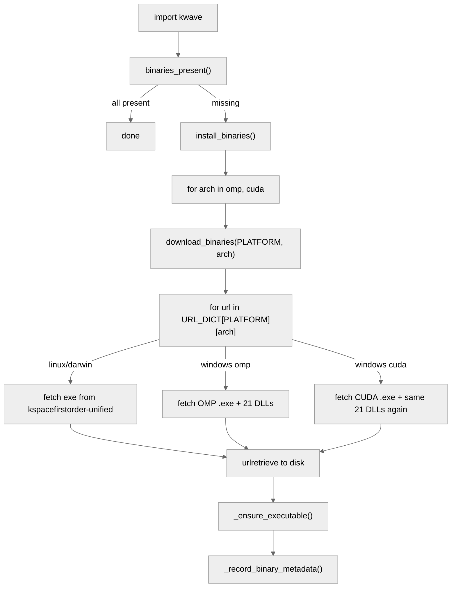
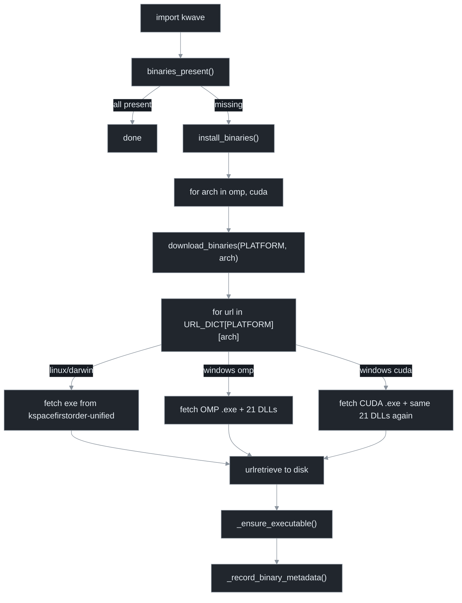

# Issue

**Title:** Flip URL_DICT to unified release + bump to 0.6.3

## Description

## Summary

Implements waltsims/k-wave-python#738. Closes that issue once v1.4.2 publishes on the unified repo.

- `BINARY_VERSION`: `v1.4.1` → `v1.4.2`
- `__version__`: `0.6.2` → `0.6.3` (auto-flows to pyproject via hatch)
- Collapses the prior 5-mirror per-platform URL scheme to a single unified release on waltsims/kspacefirstorder-unified
- Refreshes `WINDOWS_DLLS` to the actual v1.4.2 DLL set (CUDA 13 runtime + vcpkg HDF5/szip/zlib + modern MSVC CRT family)
- Removes `WINDOWS_OMP_VERSION` / `WINDOWS_CUDA_VERSION` (no longer split) and `get_windows_release_urls()` indirection
- `URL_DICT` is now a single dict-comprehension over (os, arch) pairs; helper `_platform_binary_url()` encapsulates the per-platform pattern

## Why this PR is a draft

v1.4.2 has not yet published on kspacefirstorder-unified (release-on-tag.yml workflow is in flight). The `WINDOWS_DLLS` list above was derived from the release-on-tag.yml staging step + observed CI artifact contents; once v1.4.2 actually publishes, I'll diff this list against the release's asset manifest and reconcile any names that drifted.

After that reconciliation: convert to ready-for-review.

## Test plan

- [ ] v1.4.2 publishes on kspacefirstorder-unified
- [ ] `WINDOWS_DLLS` matches the actual release asset manifest (any drift → fix)
- [ ] `uv run python -c "import kwave"` on a clean checkout downloads all binaries successfully
- [ ] Existing pytest matrix green (no test references the removed `WINDOWS_OMP_VERSION` / `get_windows_release_urls` symbols)
- [ ] At least one OMP example + one CUDA example runs end-to-end against the v1.4.2 binary

## Related

- waltsims/kspacefirstorder-unified#25 — CUDA arch expansion + Windows arch-list bug fix (merged, included in v1.4.2)
- waltsims/kspacefirstorder-unified#28 — release-on-tag DLL conflict warning (merged, lets v1.4.2 publish despite vcpkg DLL byte-drift across the two Windows backends)
- waltsims/kspacefirstorder-unified#27 — follow-up: align Windows toolchains so vcpkg DLLs are byte-identical (not blocking)
- waltsims/k-wave-python#750 — README precise GPU support claim (merged)
- waltsims/k-wave-python#755 — runtime cc<7.5 warning (merged)

<!-- greptile_comment -->

<h3>Greptile Summary</h3>

This PR collapses the previous 5-repo, per-platform binary mirror scheme into a single `kspacefirstorder-unified` release, bumps `BINARY_VERSION` to `v1.4.2` and `__version__` to `0.6.3`, and refreshes the Windows DLL bundle to match the CUDA 13 + vcpkg + modern MSVC CRT stack.

- Replaces the five platform-specific GitHub release base URLs with a single `_UNIFIED_RELEASE_URL` and a new `_platform_binary_url(architecture)` helper that builds asset URLs per backend.
- Removes `WINDOWS_OMP_VERSION`, `WINDOWS_CUDA_VERSION`, and `get_windows_release_urls()`; replaces the explicit per-platform `URL_DICT` literal with a single dict comprehension.
- Updates `WINDOWS_DLLS` from the Intel-era v1.3.0 bundle to the v1.4.2 set (21 DLLs: CUDA 13 runtime, FFTW3, vcpkg HDF5/szip/zlib, and MSVC 140 CRT family).

<h3>Confidence Score: 3/5</h3>

The URL consolidation is correct in intent, but the URL_DICT comprehension does not pass the loop platform key to `_platform_binary_url`, so every OS key in the dict holds the current machine’s URLs rather than that OS’s URLs — and the Windows DLL list is attached to both backends, causing duplicate downloads on first install.

The `_platform_binary_url` function reads the module-level `PLATFORM` global and ignores the `os` loop variable from the comprehension, meaning `URL_DICT["darwin"]` and `URL_DICT["windows"]` on a Linux host will both contain Linux asset URLs. `download_binaries(system_os, bin_type)` accepts any OS string, so any cross-platform or introspection use of the dict returns wrong data silently. Additionally, Windows DLLs are now listed under both `omp` and `cuda`, so the first install on Windows fetches all 21 DLLs twice.

`kwave/__init__.py` — the `_platform_binary_url` function and the `URL_DICT` comprehension on line 99 need attention before this is marked ready for review.

<h3>Important Files Changed</h3>

| Filename | Overview |
|----------|----------|
| kwave/__init__.py | Migrates binary download URLs from 5 per-platform repos to one unified release; bumps version to 0.6.3 / BINARY_VERSION to v1.4.2. The new URL_DICT comprehension has a latent bug: `_platform_binary_url` ignores the loop `os` key and always reads the global `PLATFORM`, so all three OS keys in the dict contain identical (current-platform) URLs. Additionally, Windows DLLs are now included in both OMP and CUDA URL lists, doubling DLL downloads on first install. |

<h3>Flowchart</h3>

Reviews (1): Last reviewed commit:  | [Re-trigger Greptile](https://app.greptile.com/api/retrigger?id=38873155)

> Greptile also left **3 inline comments** on this PR.

<!-- /greptile_comment -->

## Task

Modify the repository so that the issue described above is resolved. The repository is checked out at base commit `c632dff3643d`. Edit files in place; the verifier captures your changes via `git diff` and scores them against an oracle patch using SWE-RL-style diff-similarity reward.