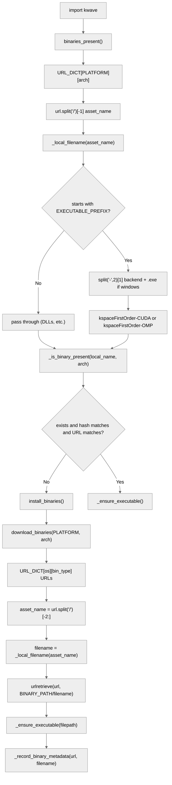
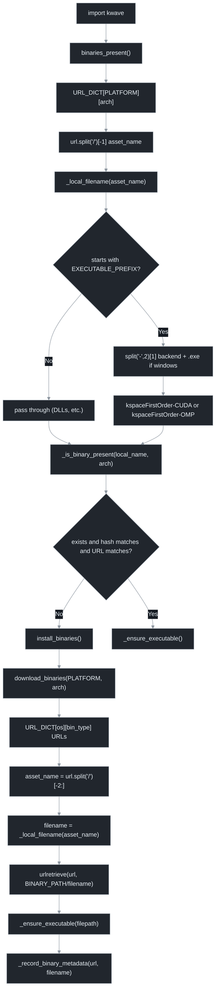

# Issue

**Title:** Fix-forward: rename-on-download + Greptile P1/P2 follow-ups for v0.6.3

## Description

## Why this PR

Addresses 4 regressions introduced by the (already-merged-and-then-reverted-in-spirit) PR #756. Branch was restored after that merge broke 4 tests on Python 3.12.

## Fixes

### 1. Test-breaker — `FileNotFoundError: Binary not found at kwave/bin/linux/kspaceFirstOrder-CUDA`

The unified release tags platform binaries with explicit suffixes (`kspaceFirstOrder-CUDA-linux`, `-windows.exe`, `-darwin`). The download code used `url.split('/')[-1]` as the local filename, so the file landed at `…/kspaceFirstOrder-CUDA-linux` while `_resolve_binary_path` / `_is_binary_present` / the test fixtures all look for the bare `…/kspaceFirstOrder-CUDA`.

**Fix:** introduce `_local_filename()` that strips the platform suffix when mapping asset name → local install filename. Used consistently in `download_binaries` and `binaries_present` so download and presence-check agree. DLLs and other non-`kspaceFirstOrder-` assets pass through unchanged.

8-case self-test in commit description; smoke test on Linux confirms binaries land at the expected paths.

### 2. Greptile P1 — `URL_DICT` had host-platform URLs under every OS key

`_platform_binary_url(architecture)` was reading the module-level `PLATFORM` global. On a Linux host, `URL_DICT["darwin"]` and `URL_DICT["windows"]` both pointed at Linux assets. Silent footgun for any cross-platform caller.

**Fix:** take `platform_name` as a required argument; build URL_DICT by passing the iteration variable.

### 3. Greptile P2 — DLLs downloaded twice on first install

Both `URL_DICT["windows"]["omp"]` and `URL_DICT["windows"]["cuda"]` carried the full 21-DLL bundle, so `install_binaries` requested every DLL twice.

**Fix:** attach DLLs only to the OMP entry (matches the old code's intent — the DLLs are shared and both backends find them via the same `BINARY_PATH`).

### 4. Greptile P2 — loop variable `os` shadowed the stdlib `os` import

**Fix:** rename to `plat`.

## Test plan

- [x] `_local_filename` self-test: 8 cases (Linux/Windows/Darwin × CUDA/OMP + DLLs) — all green
- [x] `URL_DICT` inspection: every (plat, arch) key produces correct platform-specific URLs
- [x] Local import: `python -c "import kwave"` downloads `kspaceFirstOrder-CUDA` and `kspaceFirstOrder-OMP` to `kwave/bin/linux/` (bare names, as consumer code expects)
- [ ] Full CI matrix green on this PR
- [ ] Greptile zero-issue re-review

## After this merges

k-wave-python master is healthy on v1.4.2 binaries. Then we can cut v0.6.3.

<!-- greptile_comment -->

<h3>Greptile Summary</h3>

This PR fixes four regressions introduced by the now-reverted PR #756 that caused test failures on Python 3.12 due to mismatched binary filenames after switching to the unified v1.4.2 release. The changes are surgical and well-reasoned, with each fix directly addressing a documented regression.

- Adds `_local_filename()` to strip the platform suffix (`-linux`, `-windows.exe`, `-darwin`) from unified-release asset names so that downloaded binaries land at the bare paths consumer code expects (`kspaceFirstOrder-CUDA`, not `kspaceFirstOrder-CUDA-linux`); used consistently in both `download_binaries` and `binaries_present`.
- Fixes `_platform_binary_url` to accept `platform_name` as an explicit argument so `URL_DICT` contains correct per-OS URLs regardless of the host platform, and attaches the Windows DLL bundle only to the OMP entry to prevent double-download on first install.
- Updates `test_download_sets_executable_bit` to capture the actual `urlretrieve` destination via a closure, making it robust to the suffix-stripping logic.

<h3>Confidence Score: 5/5</h3>

Safe to merge — all four targeted regressions are correctly addressed and the download/presence-check paths are now consistent.

The core changes are correct and internally consistent; the only gap is a test fixture that seeds a binary at the raw asset-name path rather than the local-filename-processed path, leaving one healing-path scenario untested against the real filename convention.

tests/test__init__.py — test_existing_non_executable_binary_is_healed seeds its binary at the raw URL tail rather than the _local_filename-processed path.

<h3>Important Files Changed</h3>

| Filename | Overview |
|----------|----------|
| kwave/__init__.py | Adds _local_filename() to strip platform suffixes, fixes _platform_binary_url to accept explicit platform_name, removes duplicate DLL attachment for CUDA, renames loop variable os→plat. Logic is consistent and correct. |
| tests/test__init__.py | test_download_sets_executable_bit correctly captures dest via closure. test_existing_non_executable_binary_is_healed still derives filename from raw URL tail (with platform suffix) rather than _local_filename, so it seeds and checks a path that doesn't match what binaries_present() would use. |

<h3>Flowchart</h3>

<!-- greptile_failed_comments -->

<h3>Comments Outside Diff (1)</h3>

1. `kwave/__init__.py`, line 184-187 ([link](https://github.com/waltsims/k-wave-python/blob/a096d3aa832393e751fba13809dff9c256382627/kwave/__init__.py#L184-L187))

    **Dead-code branch — `binary_type is None` is never reached**

   `binaries_present()` is the only call-site that feeds values into `_is_binary_present`, and it always passes a value from `ARCHITECTURES` (`"omp"` or `"cuda"`). No caller ever passes `None`, so the guard and its early-return are dead code. This was true before this PR (DLLs were already given the same `binary_type` as their parent backend), but the refactoring here makes it even clearer. The misleading comment `# this is non-kwave windows binary` implies a design that no longer exists and can cause confusion when reading the validation flow.

   Note: If this suggestion doesn't match your team's coding style, reply to this and let me know. I'll remember it for next time!

<!-- /greptile_failed_comments -->

Reviews (3): Last reviewed commit:  | [Re-trigger Greptile](https://app.greptile.com/api/retrigger?id=38900584)

<!-- /greptile_comment -->

## Task

Modify the repository so that the issue described above is resolved. The repository is checked out at base commit `23b800d04b89`. Edit files in place; the verifier captures your changes via `git diff` and scores them against an oracle patch using SWE-RL-style diff-similarity reward.