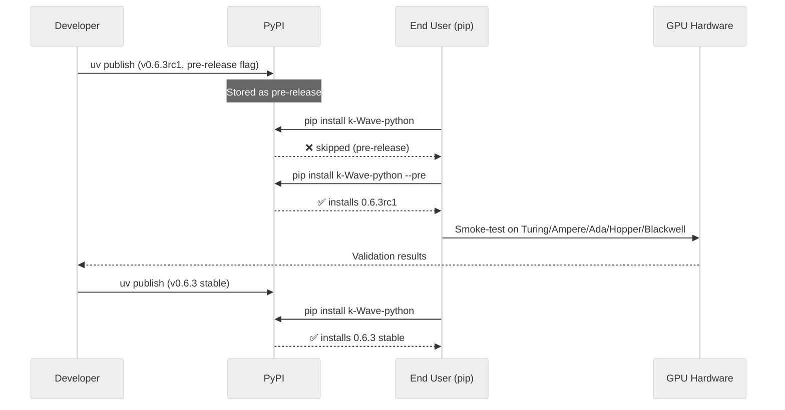
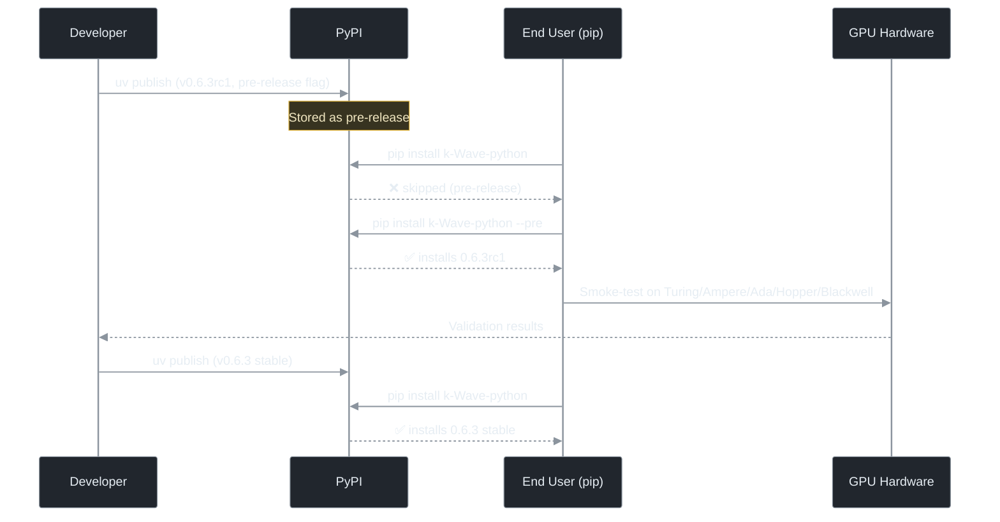

# Issue

**Title:** Bump to 0.6.3rc1 (pre-release for hardware validation)

## Description

## Why an RC

The v0.6.3 binary install path is the first user-facing payoff of the kspacefirstorder-unified consolidation work (v1.4.2 release). The path got substantially rewritten:

- \`URL_DICT\` collapsed from 5 mirror repos to one unified release
- Rename-on-download (\`kspaceFirstOrder-CUDA-linux\` → \`kspaceFirstOrder-CUDA\`)
- New runtime warning when \`device=\"gpu\"\` + cc < 7.5
- New 16-arch CUDA binary (every shipping Blackwell variant; v1.4.1 Windows regression fixed)

Cutting as \`0.6.3rc1\` so we can install + smoke-test on real GPUs (cloud + local Blackwell, Hopper, Ada, Ampere) before promoting to a stable \`0.6.3\`. \`0.6.3rc1\` is a PEP 440-compliant pre-release identifier — PyPI treats it as pre-release and \`pip\` ignores it by default, only installing with \`--pre\` or an exact pin.

## What ships with this RC

Same code as master HEAD plus the version-string flip. All the consolidation work merged today:
- #756 (URL flip)
- #755 (runtime cc<7.5 warning)
- #750 (README precise GPU support claim)
- #757 (rename-on-download fix + Greptile P1/P2 cleanups)
- #752, #754 (dependabot bumps)

## After merge

1. Tag \`v0.6.3rc1\` on this commit
2. GitHub Release with \`--prerelease\` flag + auto-generated changelog
3. PyPI publish: \`uv build && uv publish\` (or whatever existing flow)
4. Validate on real hardware:
   - Linux + CUDA on Turing/Ampere/Ada/Hopper/Blackwell
   - Windows + CUDA on at least one Blackwell card
   - Linux + OMP fallback path
5. Promote to \`0.6.3\` stable when clean

## Test plan

- [x] Identical code to master HEAD — only \`__version__\` string changes
- [ ] CI green

<!-- greptile_comment -->

<h3>Greptile Summary</h3>

This PR bumps the package version from `0.6.3` to `0.6.3rc1` in preparation for hardware validation on real GPU targets (Turing through Blackwell) before promoting to a stable release. Only one line in `kwave/__init__.py` changes; all other consolidated work (URL_DICT collapse, rename-on-download, cc<7.5 warning, new 16-arch CUDA binary) arrived via the prerequisite PRs already merged to master.

- `kwave/__init__.py`: `__version__` string changed from `"0.6.3"` to `"0.6.3rc1"`, which Hatchling reads via `[tool.hatch.version] path = "kwave/__init__.py"` — the build tooling will correctly emit the pre-release version on PyPI.
- No logic, behaviour, or dependency changes are included; the RC label means `pip install k-Wave-python` will ignore this release by default (requires `--pre` or an exact pin).

<h3>Confidence Score: 5/5</h3>

Safe to merge — the change is a one-line version string update with no behavioural impact.

Only the __version__ string changes. The PEP 440 rc1 suffix is correctly formed and Hatchling will read it without issue. PyPI will correctly treat this as a pre-release, invisible to users who run a plain pip install.

No files require special attention.

<h3>Important Files Changed</h3>

| Filename | Overview |
|----------|----------|
| kwave/__init__.py | Single-line version bump from "0.6.3" to "0.6.3rc1"; no logic changes. PEP 440-compliant pre-release identifier correctly read by Hatchling. |

<h3>Sequence Diagram</h3>

Reviews (1): Last reviewed commit:  | [Re-trigger Greptile](https://app.greptile.com/api/retrigger?id=38902203)

<!-- /greptile_comment -->

## Task

Modify the repository so that the issue described above is resolved. The repository is checked out at base commit `3afd71344b61`. Edit files in place; the verifier captures your changes via `git diff` and scores them against an oracle patch using SWE-RL-style diff-similarity reward.