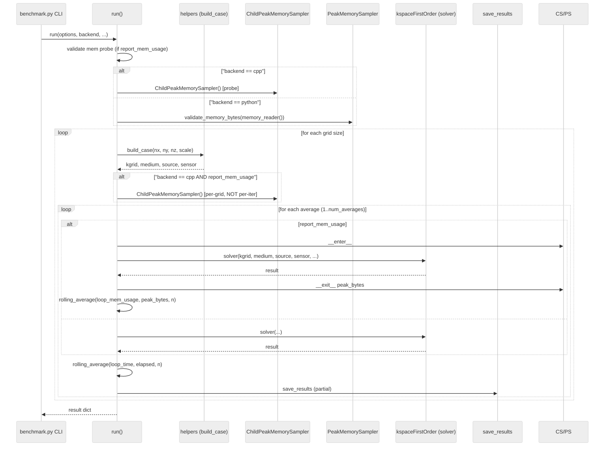
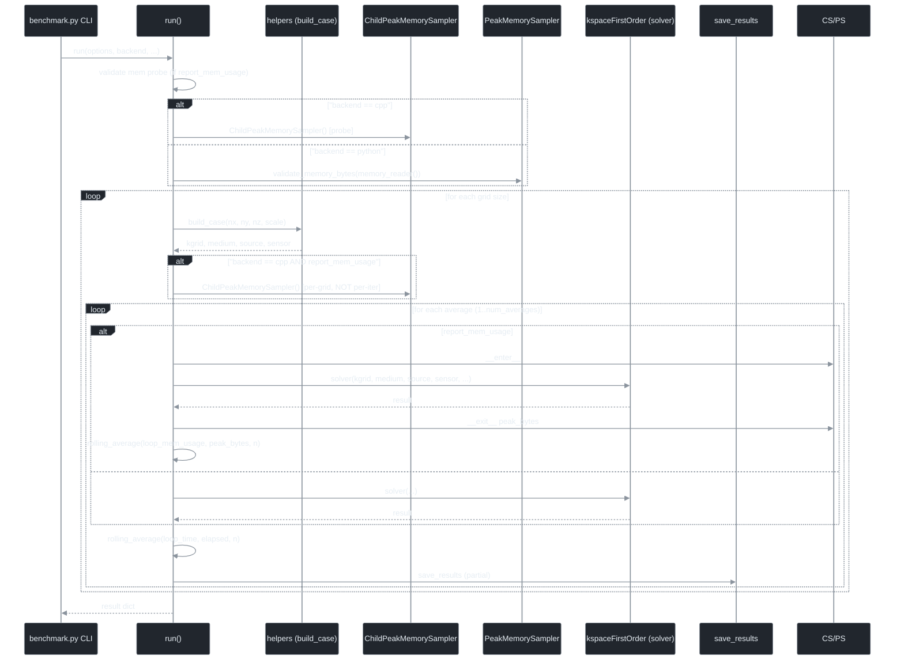

# Issue

**Title:** Migrate Benchmark (review follow-up to #731 + master merge)

## Description

## Why a separate PR

This PR carries forward [@faridyagubbayli](https://github.com/faridyagubbayli)'s benchmark migration from #731 and adds the fixes that came out of code review on that thread. I'd have pushed directly to #731 but its `maintainerCanModify` flag is `false`, so a new PR was the path of least friction. **All of @faridyagubbayli's original commits are preserved as-is**; my changes are stacked on top as a single new commit with co-authorship. Once this merges, #731 can be closed as superseded.

## What's included

### From #731 (faridyagubbayli, unchanged)
- Port of MATLAB k-Wave's `benchmark.m` to `benchmarks/benchmark.py` + `benchmarks/helpers.py`
- 9 hermetic tests (`tests/test_benchmark.py`)
- README with usage and output format

### Merge of `master`
- Brings in everything that landed since the branch's last sync (#750, #755, #756, #757, #758, dependabot bumps). Clean merge, no conflicts.

### Review-feedback fixes (this PR's contribution)

#### cpp-backend memory measurement (P1)
`benchmark.py` exposes `--backend cpp`, but `PeakMemorySampler` reads the *Python* process RSS. When the cpp backend is active, the simulation runs in a separate subprocess (the `kspaceFirstOrder-OMP`/`-CUDA` binary) — so Python RSS reflects ~nothing about its memory footprint and `mem_usage` becomes silently meaningless.

The MATLAB original only ever exercised in-process `kspaceFirstOrder3D` (never the subprocess `kspaceFirstOrder3DC`), so the equivalent question didn't come up there. The Python port introduced the cpp-backend benchmark option without extending memory measurement to match.

**Fix:** add `ChildPeakMemorySampler` using `resource.getrusage(RUSAGE_CHILDREN).ru_maxrss` before/after the subprocess. Zero new dependencies (stdlib only). Linux returns KB, macOS returns bytes — normalized to bytes. Windows is unsupported (`resource` is POSIX-only); `--report-mem-usage` + `backend=\"cpp\"` on Windows now refuses with a clear `ValueError` at startup, before any output file is written. `benchmark.run()` picks the sampler factory automatically; tests override via the new `mem_sampler_factory=` kwarg.

#### Rename `peak_memory_bytes` → `current_memory_bytes` (P2)
The Linux (`/proc/self/statm` field [1]), macOS (`ps -o rss=`), and Windows (`WorkingSetSize`) readers all return *current* RSS, not historical peak. Only `PeakMemorySampler` (which polls in a background thread) finds a peak over time. Rename to reflect what the readers actually do. `peak_memory_bytes` retained as a back-compat alias.

#### `__post_init__` validation guards (P3)
Three cheap guards that prevent opaque `ZeroDivisionError`s downstream: `domain_size > 0`, `sensor_radius > 0`, `pml_size >= 0`.

#### Code comments
- Density slab `[max(ny//4 - 1, 0):, :]` — why the `-1` is asymmetric with the head slice `[:nx//4, :]` (1-indexed vs 0-indexed).
- `make_ball(... Vector([nx//2, ny//2, nz//2]) ...)` — `make_ball` treats the supplied center as 1-indexed, so this matches MATLAB's `Nx/2` despite looking off-by-one.
- `source.p0 = smooth(...).astype(dtype)` — `smooth()` upcasts to float64 via the FFT path; the trailing astype restores user dtype.

#### README clarifications
- `data_cast=\"single\"` is a no-op for `backend=\"cpp\"` (binary always serializes as float32); only meaningful for `backend=\"python\"`.
- `--report-mem-usage` + backend interaction documented per above (with the MATLAB context).

#### Inline `bon_a`
The local was always computed but only used in the `options.nonlinear_media` branch (default `False`).

## Test plan

- 9 new test cases (18 total): back-compat alias, three validation guards (parametrized × 5 cases), cpp-backend factory invocation, Windows-cpp clear-error path, `ChildPeakMemorySampler` Windows refusal.
- All 18 pass locally (Linux + Python 3.12).
- Existing tests unchanged.

## Out of scope for this PR

- The optional Windows `PeakWorkingSetSize` shortcut (already in the struct definition at `helpers.py:208`, just unused) — would let Windows skip the sampler thread for `backend=\"python\"`. Easy follow-up.
- `benchmarks/` is correctly excluded from the wheel (`[tool.hatch.build.targets.wheel] packages` allowlist); it does land in the sdist (cosmetic — sdists routinely carry dev material). Left as-is.

.

<!-- greptile_comment -->

<h3>Greptile Summary</h3>

This PR carries forward the MATLAB `benchmark.m` port from #731 and adds targeted fixes identified during code review: a correct `ChildPeakMemorySampler` that captures its `ru_maxrss` baseline once per grid (avoiding the per-iteration delta-collapse problem for uniform workloads), input validation guards on `BenchmarkOptions`, `psutil` added to the `test` extra so CI collection succeeds, and clarifying comments throughout.

- **`ChildPeakMemorySampler`** (cpp backend): one instance is created per grid size and reused across all `num_averages` iterations; `peak_bytes` is the cumulative growth since the grid's baseline, which equals the per-iteration peak for uniform workloads — the typical benchmark case.
- **`PeakMemorySampler`** (python backend): a new instance is created per iteration with a polling background thread; correct for in-process RSS tracking.
- **Validation & robustness**: `__post_init__` guards prevent opaque downstream errors; the early probe in `run()` surfaces unsupported platform/backend combinations before any output file is written.

<h3>Confidence Score: 5/5</h3>

Safe to merge; all new code is confined to benchmarks/ and tests with no changes to the core kwave library.

All changes are additive benchmark infrastructure. The cpp-backend memory measurement fix is correctly implemented and tested. No files require special attention.

No files require special attention.

<h3>Important Files Changed</h3>

| Filename | Overview |
|----------|----------|
| benchmarks/helpers.py | Core benchmark utilities: BenchmarkOptions dataclass with validation guards, build_case, ChildPeakMemorySampler (per-grid baseline fix for cpp backend), PeakMemorySampler (threaded polling for python backend), and JSON serialization helpers. |
| benchmarks/benchmark.py | Main run() function orchestrates grid-size sweep; correctly creates one ChildPeakMemorySampler per grid (not per iteration) and a new PeakMemorySampler per iteration for the Python backend. Early probe ensures unsupported platform/backend combos fail before writing output. |
| tests/test_benchmark.py | 18 tests covering timing aggregation, memory sampling, JSON output, error propagation, validation guards, and the cpp sampler lifetime model. _FakeChildSampler uses class-level state with explicit reset(); adequate coverage of the key correctness invariants. |
| pyproject.toml | Adds psutil to both the test and benchmark extras, ensuring CI (pip install '.[test]') can import benchmarks.helpers without ModuleNotFoundError at collection time. |
| benchmarks/README.md | Clear usage guide; documents data_cast no-op caveat for cpp backend and --report-mem-usage platform constraints. |
| benchmarks/__init__.py | Minimal package init; marks benchmarks/ as an importable package for test collection. |

<h3>Sequence Diagram</h3>

<!-- greptile_failed_comments -->

<h3>Comments Outside Diff (2)</h3>

1. `tests/test_benchmark.py`, line 824-860 ([link](https://github.com/waltsims/k-wave-python/blob/08d8da69363f9ac9e1078d63cf1da4e2964b0128/tests/test_benchmark.py#L824-L860))

    **Test doesn't verify memory value correctness for multiple averages**

   `test_cpp_backend_uses_child_sampler_via_factory` uses `num_averages=2` but only asserts `len(result["mem_usage"]) == 1` — it never checks the actual reported value. The `FakeChildSampler` also returns increasing values (`1024 * len(sampler_calls)`) which would not expose the real-world `ChildPeakMemorySampler` bug where the cumulative `ru_maxrss` baseline for iteration 2 equals iteration 1's peak, producing `delta=0`.

   Adding an assertion like `assert result["mem_usage"][0] == pytest.approx(expected_average)` with a `FakeChildSampler` whose `peak_bytes` is constant (e.g., always `4096.0`) would both verify averaging logic and catch the cumulative-delta regression when `ChildPeakMemorySampler` is used with `num_averages > 1`.

   Note: If this suggestion doesn't match your team's coding style, reply to this and let me know. I'll remember it for next time!

2. `pyproject.toml`, line 46-53 ([link](https://github.com/waltsims/k-wave-python/blob/95e802f9f7dd74ca6a71847d6f6ddf464b5d469a/pyproject.toml#L46-L53))

    `benchmarks/helpers.py` imports `psutil` unconditionally at the top of the module. `tests/test_benchmark.py` imports from that module, so pytest collection of the test file will fail with `ModuleNotFoundError: No module named 'psutil'` whenever only the `test` extra is installed. The CI workflow (`.github/workflows/pytest.yml` line 108) runs exactly `pip install '.[test]'`, so the benchmark tests will fail to collect on every CI run.

<!-- /greptile_failed_comments -->

Reviews (8): Last reviewed commit:  | [Re-trigger Greptile](https://app.greptile.com/api/retrigger?id=38927540)

<!-- /greptile_comment -->

## Task

Modify the repository so that the issue described above is resolved. The repository is checked out at base commit `8e738e140b30`. Edit files in place; the verifier captures your changes via `git diff` and scores them against an oracle patch using SWE-RL-style diff-similarity reward.