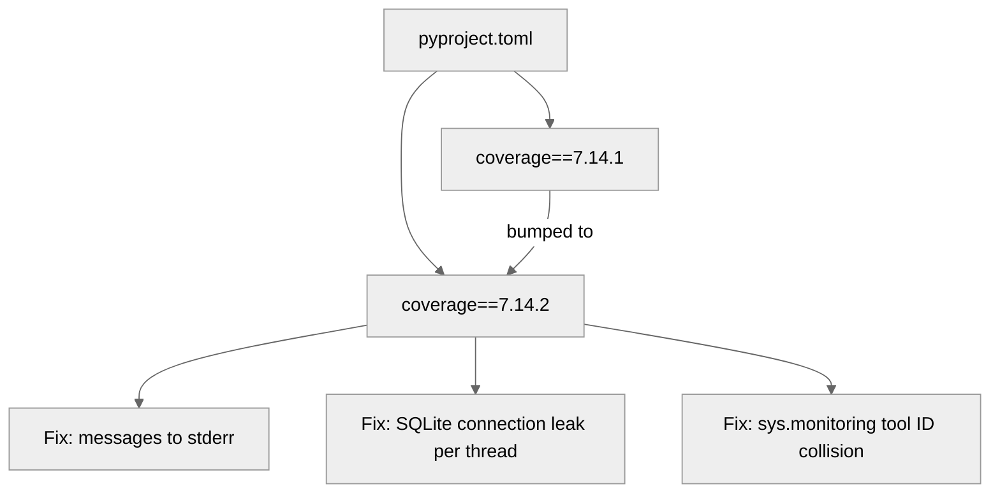
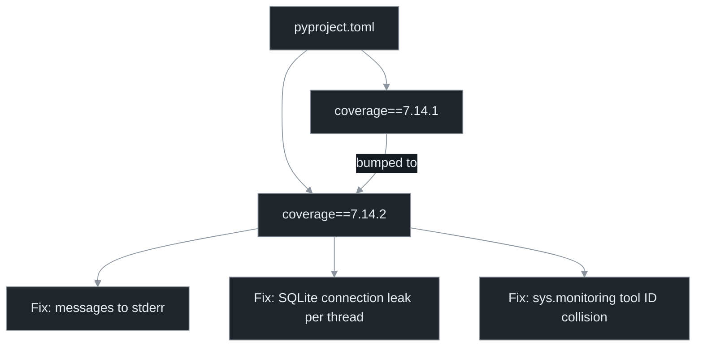

# Issue

**Title:** Bump coverage from 7.14.1 to 7.14.2

## Description

Bumps [coverage](https://github.com/coveragepy/coveragepy) from 7.14.1 to 7.14.2.

Changelog

<em>Sourced from <a href="https://github.com/coveragepy/coveragepy/blob/main/CHANGES.rst">coverage's changelog</a>.</em>

<blockquote>
<h2>Version 7.14.2 — 2026-06-20</h2>
<ul>
<li>

Fix: some messages were being written to stdout, making <code>coverage json -o -</code> useless for capturing JSON output. Now messages are written to stderr,
fixing <code>issue 2197</code>_.

</li>
<li>

Fix: <code>CoverageData</code> kept one SQLite connection per thread that recorded
coverage, but never closed them when those threads terminated. On long runs
with many short-lived threads this leaked one file descriptor per dead
thread, eventually failing with <code>OSError: [Errno 24] Too many open files</code>.
Connections belonging to terminated threads are now closed and dropped.
Fixes <code>issue 2192</code><em>.  Thanks, <code>Matthew Lloyd &lt;pull 2193_&gt;</code></em>.

</li>
<li>

Fix: when using sys.monitoring, we were assuming we could use the
<code>COVERAGE_ID</code> tool id.  But other tools might also assume they could use
that id.  Pre-allocated ids don't really make sense, so now we search for a
usable one instead. Fixes <code>issue 2187</code>_.

</li>
<li>

Following <code>the advice of cibuildwheel &lt;no-13t_&gt;</code>_, we no longer distribute
wheels for Python 3.13 free-threaded.

</li>
</ul>

.. _issue 2187: <a href="">coveragepy/coveragepy#2187</a>
.. _issue 2192: <a href="">coveragepy/coveragepy#2192</a>
.. _pull 2193: <a href="">coveragepy/coveragepy#2193</a>
.. _issue 2197: <a href="">coveragepy/coveragepy#2197</a>
.. _no-13t: <a href="https://py-free-threading.github.io/ci/#building-free-threaded-wheels-with-cibuildwheel">https://py-free-threading.github.io/ci/#building-free-threaded-wheels-with-cibuildwheel</a>

.. _changes_7-14-1:

</blockquote>

Commits

<ul>
<li><a href=""><code>153f932</code></a> docs: sample HTML for 7.14.2</li>
<li><a href=""><code>311bc67</code></a> docs: prep for 7.14.2</li>
<li><a href=""><code>7f314be</code></a> docs: thanks, Matthew Lloyd <a href="">#2193</a></li>
<li><a href=""><code>f960696</code></a> Fix: close SQLite connections from terminated threads (<a href="">#2192</a>) (<a href="">#2193</a>)</li>
<li><a href=""><code>2429615</code></a> docs: fix a changelog entry</li>
<li><a href=""><code>ced7f8a</code></a> build: cibuildwheel 4.0.0 no longer has this enable option</li>
<li><a href=""><code>30a567c</code></a> chore: make upgrade</li>
<li><a href=""><code>27c11f1</code></a> fix: write messages to stderr. <a href="">#2197</a></li>
<li><a href=""><code>bdbe01f</code></a> chore: bump the action-dependencies group with 3 updates (<a href="">#2191</a>)</li>
<li><a href=""><code>dc2fd3b</code></a> chore: bump the action-dependencies group with 2 updates (<a href="">#2188</a>)</li>
<li>Additional commits viewable in <a href="https://github.com/coveragepy/coveragepy/compare/7.14.1...7.14.2">compare view</a></li>
</ul>

 

Dependabot will resolve any conflicts with this PR as long as you don't alter it yourself. You can also trigger a rebase manually by commenting `@dependabot rebase`.

[//]: # (dependabot-automerge-start)
[//]: # (dependabot-automerge-end)

---

Dependabot commands and options

 

You can trigger Dependabot actions by commenting on this PR:
- `@dependabot rebase` will rebase this PR
- `@dependabot recreate` will recreate this PR, overwriting any edits that have been made to it
- `@dependabot show <dependency name> ignore conditions` will show all of the ignore conditions of the specified dependency
- `@dependabot ignore this major version` will close this PR and stop Dependabot creating any more for this major version (unless you reopen the PR or upgrade to it yourself)
- `@dependabot ignore this minor version` will close this PR and stop Dependabot creating any more for this minor version (unless you reopen the PR or upgrade to it yourself)
- `@dependabot ignore this dependency` will close this PR and stop Dependabot creating any more for this dependency (unless you reopen the PR or upgrade to it yourself)

<!-- greptile_comment -->

<h3>Greptile Summary</h3>

This PR bumps the `coverage` dev dependency from 7.14.1 to 7.14.2 in `pyproject.toml`. The new patch release includes three bug fixes: messages being incorrectly written to stdout instead of stderr, SQLite connection leaks from terminated threads causing file descriptor exhaustion on long runs with many short-lived threads, and a `sys.monitoring` tool ID collision fix.

- Single-line version pin update in `pyproject.toml` — no functional application code is changed.
- All three fixes in 7.14.2 are improvements to coverage's own internals and are relevant to CI test collection workloads.

<h3>Confidence Score: 5/5</h3>

This is a safe, isolated patch-version bump of a test-only dependency with no changes to application code.

The only change is a single version pin update for `coverage` in the test extras of `pyproject.toml`. The 7.14.2 release is a pure bug-fix patch that improves stdout/stderr handling, fixes a file-descriptor leak on long multi-threaded test runs, and resolves a `sys.monitoring` tool ID conflict — all strictly beneficial for CI reliability.

No files require special attention.

<h3>Important Files Changed</h3>

| Filename | Overview |
|----------|----------|
| pyproject.toml | Single-line patch version bump of the `coverage` test dependency from 7.14.1 to 7.14.2; no other changes. |

<h3>Flowchart</h3>

Reviews (1): Last reviewed commit:  | [Re-trigger Greptile](https://app.greptile.com/api/retrigger?id=39148129)

<!-- /greptile_comment -->

## Task

Modify the repository so that the issue described above is resolved. The repository is checked out at base commit `e303fdedd7cd`. Edit files in place; the verifier captures your changes via `git diff` and scores them against an oracle patch using SWE-RL-style diff-similarity reward.